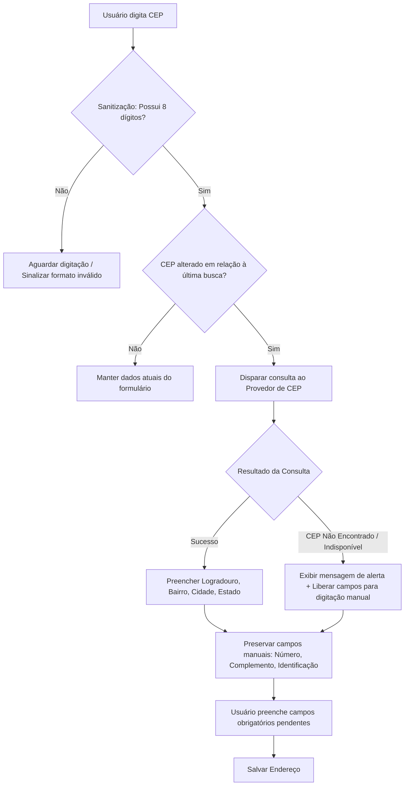
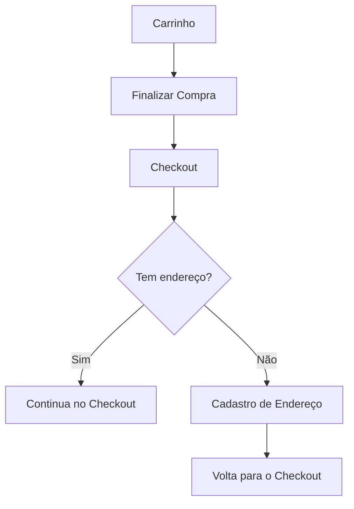

# Especificação Funcional — Domínio de Endereço & Validação de Checkout (ViaCEP)

---

## 1. Objetivo

Definir o comportamento funcional do domínio de Gerenciamento de Endereços do Usuário (`Address`) no e-commerce **Origem Vinhos**, contemplando o cadastro, edição, exclusão e listagem de endereços, a regra de Endereço Padrão, a integração desacoplada com provedores de consulta de CEP (POC ViaCEP) com preenchimento automático, e o início da esteira de Checkout através da validação obrigatória de endereço prévio para prosseguimento da compra.

---

## 2. Escopo

Esta especificação contempla:

* Gestão funcional completa de endereços associados a um usuário autenticado (CRUD: Criar, Visualizar, Editar e Excluir);
* Suporte a múltiplos endereços por usuário, sem limite máximo configurado;
* Gestão e atribuição do **Endereço Padrão** (definição automática do 1º endereço, alteração manual pelo usuário e reatribuição automática na exclusão do endereço padrão);
* Sanitização, validação de formato e gatilho de consulta de CEP contendo exatamente 8 dígitos numéricos;
* Preenchimento automático e parcial dos campos de endereço retornados pelo provedor externo;
* Contingência e *fallback* para preenchimento manual completo em casos de erro de formato, CEP inexistente, *timeout* ou indisponibilidade do provedor externo;
* Preservação irrestrita dos dados informados manualmente pelo usuário durante falhas de consulta ou alteração de CEP;
* Desacoplamento arquitetural funcional entre o domínio de endereço e o provedor externo de consulta de CEP;
* Validação de pré-requisito de endereço no início do fluxo de Checkout (ação "Finalizar Compra" no Carrinho);
* Bloqueio de avanço no Checkout para usuários sem endereço válido cadastrado, com direcionamento para a tela de cadastro e retorno automático ao fluxo de compra iniciado.

---

## 3. Fora de Escopo

Esta especificação **não contempla**:

* Integração direta com a API oficial ou site dos Correios (a POC utiliza o provedor **ViaCEP** em `https://viacep.com.br` isolado por uma camada de abstração de serviço);
* Processamento de pagamentos, cobranças ou integração com *gateways* financeiros;
* Cálculo ativo de frete, estimativas de prazo de entrega ou regras de logística;
* Geração de número de pedido, fechamento fiscal ou persistência transacional de compras (`Orders`);
* Consulta ou seleção de pontos de retirada (*lockers*, agências ou retirada em loja);
* Validação geográfica ou física da existência do número predial informado;
* Geolocalização (coordenadas de latitude e longitude).

---

## 4. Fluxo Funcional

### 4.1 Consulta de CEP e Preenchimento do Formulário
1. O usuário autenticado acessa a tela de cadastro ou edição de endereço.
2. O usuário digita o CEP no campo correspondente (com ou sem formatação/hífen).
3. O sistema sanitiza o valor, mantendo apenas os caracteres numéricos.
4. Quando o valor sanitizado atinge **exatamente 8 dígitos**, o sistema dispara automaticamente a consulta ao provedor de CEP (ViaCEP).
5. **Cenário A — Sucesso na Consulta:**
   * Os campos retornados pelo provedor (Logradouro, Bairro, Cidade, Estado e Complemento quando aplicável) são preenchidos automaticamente na interface.
   * Os campos manuais (Número, Complemento caso ausente na resposta e Identificação do Endereço) ficam disponíveis para preenchimento pelo usuário.
6. **Cenário B — CEP Não Encontrado ou Indisponibilidade Técnica:**
   * O sistema exibe uma mensagem informativa clara sobre o ocorrido.
   * Todos os campos do formulário são liberados para preenchimento manual.
   * Quaisquer dados previamente digitados pelo usuário (ex: Número, Complemento ou Identificação) são integralmente mantidos na tela.
7. O usuário revisa as informações, preenche os campos obrigatórios pendentes e confirma o salvamento.

### 4.2 Fluxo de Transição do Carrinho para o Checkout
1. No **Carrinho de Compras**, o usuário clica na ação **"Finalizar Compra"**.
2. O sistema navega para a tela de **Checkout**.
3. No **Checkout**, o sistema valida se o usuário possui ao menos um endereço cadastrado (**Tem endereço?**).
4. **Cenário A — Sim → Continua:**
   * O usuário permanece no Checkout e o sistema pré-seleciona o seu **Endereço Padrão**.
5. **Cenário B — Não → Cadastro de Endereço → Volta para o Checkout:**
   * O sistema identifica a ausência de endereço, exibe alerta explicativo e direciona o usuário para a tela de **Cadastro de Endereço**.
   * O usuário realiza o cadastro do endereço e confirma o salvamento.
   * Após o cadastro bem-sucedido, o sistema navega de **Volta para o Checkout** automaticamente.

---

## 5. Regras de Negócio

### RN-END-01: Associação com Usuário e Autenticação
* Cada endereço cadastrado pertence obrigatoriamente a um único usuário autenticado (relacionamento 1:N entre `User` e `Address`).
* Apenas o próprio usuário autenticado pode cadastrar, visualizar, editar ou excluir seus endereços.

### RN-END-02: Campos do Endereço e Obrigatoriedade
* O modelo de dados do endereço é composto pelos seguintes campos:

| Campo | Preenchimento Automático (CEP) | Obrigatoriedade no Cadastro | Observação |
|---|---|---|---|
| **CEP** | Não (Entrada) | **Obrigatorio** | Sanitizado para 8 dígitos |
| **Logradouro** | Sim | **Obrigatorio** | Rua, avenida, praça, etc. |
| **Número** | Não | **Obrigatorio** | Número predial |
| **Complemento** | Sim (quando fornecido) | *Opcional* | Bloco, apartamento, sala |
| **Bairro** | Sim | **Obrigatorio** | Bairro ou distrito |
| **Cidade** | Sim | **Obrigatorio** | Município |
| **Estado (UF)** | Sim | **Obrigatorio** | Sigla da Unidade Federativa (2 letras) |
| **Identificação do Endereço** | Não | **Obrigatorio** | Rótulo/Apelido (ex: "Casa", "Trabalho") |
| **Indicador de Padrão** | Não | **Obrigatorio** | Booleano indicando se é o endereço padrão |

* Um endereço só poderá ser salvo se **todos os campos obrigatórios** estiverem devidamente preenchidos.
* Caso o usuário tente salvar o formulário sem informar a **Identificação do Endereço**, o sistema deve solicitar o seu preenchimento e bloquear o salvamento.

### RN-END-03: Sanitização e Gatilho do CEP
* O sistema deve aceitar a digitação do CEP contendo pontuações e caracteres de máscara (ex: `01001-000`).
* Antes de avaliar o acionamento da consulta, o sistema deve remover todos os caracteres não numéricos.
* A consulta externa **somente deve ser executada** quando o CEP sanitizado possuir exatamente 8 dígitos numéricos.
* CEPs sanitizados com extensão diferente de 8 dígitos não devem disparar chamadas externas e devem ser sinalizados como "formato inválido".

### RN-END-04: Prevenção de Consultas Repetidas e Preservação de Dados
* Enquanto o valor do CEP sanitizado permanecer inalterado no formulário, o sistema não deve efetuar novas consultas externas.
* Caso o usuário altere o CEP para outro valor válido de 8 dígitos, uma nova consulta deve ser realizada automaticamente.
* Durante o preenchimento automático oriundo de uma nova consulta, os campos de endereço (Logradouro, Bairro, Cidade, Estado) podem ser atualizados com as novas informações retornadas.
* Os campos preenchidos manualmente pelo usuário (como **Número**, **Complemento** e **Identificação do Endereço**) **nunca devem ser sobrescritos** por consultas subsequentes de CEP.

### RN-END-05: Fallback Manual e Resiliência
* Se a consulta de CEP resultar em:
  1. CEP com formato inválido;
  2. Resposta de "CEP não encontrado" pelo provedor;
  3. Indisponibilidade técnica, erro HTTP ou *timeout* na chamada externa;
* O sistema deve:
  * Exibir uma mensagem explicativa ao usuário;
  * Habilitar todos os campos do formulário para edição/preenchimento manual completo;
  * Manter intactos todos os valores já digitados pelo usuário até aquele momento.

### RN-END-06: Regras do Endereço Padrão (*Default Address*)
1. **Atribuição Inicial Automática:** O primeiro endereço cadastrado por um usuário será definido automaticamente como o seu Endereço Padrão (`isDefault = true`).
2. **Alteração Manual:** O usuário pode a qualquer momento selecionar outro de seus endereços cadastrados e marcá-lo como o novo Endereço Padrão. Ao fazer isso, o endereço anteriormente marcado perde a condição de padrão.
3. **Reatribuição Automática na Exclusão:** Caso o usuário exclua o seu Endereço Padrão atual e ainda possua outros endereços em sua conta, o sistema deve definir automaticamente o endereço cadastrado mais recentemente como o novo Endereço Padrão.
4. **Uso no Checkout:** O fluxo de Checkout pré-selecionará automaticamente o Endereço Padrão do usuário para o início da operação.

### RN-END-07: Desacoplamento do Provedor de CEP
* A consulta de CEP deve ser isolada por uma interface de abstração do serviço de localização (*Port*).
* As regras de negócio do domínio de Endereço e da interface do usuário não devem possuir dependência direta com as estruturas de contrato JSON especificas do ViaCEP.
* O sistema deve permitir a substituição futura da POC ViaCEP pela API oficial dos Correios (ou outro provedor) mediante alteração exclusiva da camada de infraestrutura/adapter, sem impacto nas regras deste domínio.

### RN-END-08: Início de Checkout e Validação de Endereço
* A ação **"Finalizar Compra"** localizada no Carrinho de Compras inicia o fluxo de Checkout.
* Esta versão do Checkout possui a responsabilidade estrita de validar os pré-requisitos da compra.
* O primeiro pré-requisito obrigatório é a **existência de pelo menos 1 endereço válido** vinculado à conta do usuário.
* Se o usuário **não possuir endereço**:
  1. O avanço é bloqueado;
  2. O usuário é alertado sobre a necessidade do cadastro;
  3. O usuário é redirecionado automaticamente para a tela de cadastro de endereço;
  4. O estado da intenção de Checkout é temporariamente retido.
* Após salvar o endereço com sucesso, o sistema deve **retornar automaticamente** o usuário para o fluxo de Checkout de onde parou.
* Caso o usuário exclua todos os seus endereços (ficando com 0 endereços), ele ficará novamente impossibilitado de iniciar o Checkout até que um novo endereço seja cadastrado.

---

## 6. Modelo Conceitual do Domínio

```
┌────────────────────────────────┐       1:N       ┌────────────────────────────────┐
│             User               ├─────────────────┤            Address             │
├────────────────────────────────┤                 ├────────────────────────────────┤
│ - id: UUID                     │                 │ - id: UUID                     │
│ - name: String                 │                 │ - userId: UUID                 │
│ - email: String                │                 │ - zipCode: String (8 dígitos)  │
└────────────────────────────────┘                 │ - street: String               │
                                                   │ - number: String               │
                                                   │ - complement: String (Opcional)│
                                                   │ - neighborhood: String         │
                                                   │ - city: String                 │
                                                   │ - state: String (2 letras)     │
                                                   │ - label: String ("Casa", etc)   │
                                                   │ - isDefault: Boolean           │
                                                   │ - createdAt: DateTime          │
                                                   │ - updatedAt: DateTime          │
                                                   └────────────────────────────────┘
                                                                   │
                                                                   │ utiliza
                                                                   ▼
                                                   ┌────────────────────────────────┐
                                                   │        CepLookupService        │
                                                   │            (Port)              │
                                                   ├────────────────────────────────┤
                                                   │ + lookup(zipCode): CepResult   │
                                                   └────────────────────────────────┘
                                                                   ▲
                                                                   │ implementa
                                                   ┌────────────────────────────────┐
                                                   │        ViaCepAdapter           │
                                                   │           (Adapter)            │
                                                   └────────────────────────────────┘
```

---

## 7. Casos de Uso

### UC-END-01: Cadastrar Endereço com Preenchimento por CEP
* **Ator Principal:** Usuário Autenticado.
* **Pré-condição:** Usuário logado na plataforma.
* **Fluxo Principal:**
  1. Usuário aciona o cadastro de novo endereço.
  2. Informa CEP válido de 8 dígitos.
  3. Sistema consulta o provedor de CEP e preenche automaticamente Logradouro, Bairro, Cidade e Estado.
  4. Usuário informa o Número, Complemento (opcional) e a Identificação do Endereço (ex: "Casa").
  5. Usuário confirma o cadastro.
  6. Sistema valida o preenchimento de todos os campos obrigatórios.
  7. Se for o primeiro endereço do usuário, o sistema marca `isDefault = true`.
  8. O endereço é salvo e associado ao usuário.

### UC-END-02: Cadastrar Endereço Manualmente (Fallback)
* **Ator Principal:** Usuário Autenticado.
* **Fluxo Alternativo:**
  1. Usuário informa CEP que não é localizado na API externa ou durante indisponibilidade do serviço.
  2. Sistema exibe alerta e libera todos os campos para digitação manual.
  3. Usuário preenche manualmente Logradouro, Número, Bairro, Cidade, Estado e Identificação do Endereço.
  4. Usuário confirma o cadastro.
  5. Sistema valida a presença dos campos obrigatórios e salva o endereço.

### UC-END-03: Editar Endereço Existente
* **Ator Principal:** Usuário Autenticado.
* **Fluxo Principal:**
  1. Usuário visualiza sua lista de endereços e seleciona "Editar" em um endereço.
  2. O formulário exibe os dados atuais do endereço.
  3. O usuário altera os dados desejados (ex: altera o CEP ou o número).
  4. Se o CEP for modificado para um novo CEP de 8 dígitos, o sistema consulta novamente e atualiza os campos de localização sem alterar Número ou Identificação.
  5. Usuário confirma a alteração.
  6. O sistema valida e atualiza o registro.

### UC-END-04: Excluir Endereço
* **Ator Principal:** Usuário Autenticado.
* **Fluxo Principal:**
  1. Usuário solicita a exclusão de um endereço.
  2. O sistema solicita confirmação.
  3. Usuário confirma.
  4. O endereço é removido da conta do usuário.
  5. Se o endereço removido era o **Endereço Padrão** e restarem outros endereços, o sistema elege o endereço restante mais recente como o novo Padrão.

### UC-END-05: Definir Endereço Padrão
* **Ator Principal:** Usuário Autenticado.
* **Fluxo Principal:**
  1. Usuário visualiza sua lista de endereços.
  2. Seleciona a opção "Definir como Padrão" em um endereço secundário.
  3. O sistema atualiza o endereço selecionado para `isDefault = true` e desmarca o anterior.

### UC-END-06: Iniciar Checkout com Validação de Endereço
* **Ator Principal:** Usuário Autenticado.
* **Pré-condição:** Usuário possui itens no carrinho.
* **Fluxo Principal:**
  1. No Carrinho, usuário clica em "Finalizar Compra".
  2. Sistema verifica a quantidade de endereços do usuário.
  3. **Se possui endereços:** Avança para a tela inicial do Checkout exibindo o Endereço Padrão selecionado.
  4. **Se tem 0 endereços:** Intercepta a navegação, notifica a obrigatoriedade do endereço, redireciona para a tela de cadastro e, após o cadastro, retorna o usuário para o Checkout.

---

## 8. Critérios de Aceite

| Cenário | Dado que... | Quando... | Então... |
|---|---|---|---|
| **1. Consulta de CEP válido** | O usuário esteja cadastrando um endereço | Informar um CEP de 8 dígitos válido | O sistema consulta o ViaCEP e preenche automaticamente Logradouro, Bairro, Cidade e Estado. |
| **2. CEP com máscara** | O usuário digite um CEP formatado (ex: `01001-000`) | O sistema processar o CEP | Deve remover pontuações e realizar a consulta utilizando apenas os 8 dígitos numéricos. |
| **3. Preenchimento de dados complementares** | O CEP for consultado com sucesso | O usuário preencher Número e Identificação e salvar | O endereço deve ser registrado e associado ao usuário. |
| **4. CEP com formato inválido** | O usuário esteja digitando o CEP | O CEP possuir número de dígitos diferente de 8 | O sistema não deve realizar chamada à API externa e deve sinalizar CEP inválido. |
| **5. CEP não encontrado** | O usuário informe um CEP válido de 8 dígitos | O provedor retornar indicativo de CEP inexistente | O sistema deve notificar que o CEP não foi encontrado e permitir o preenchimento manual completo. |
| **6. Indisponibilidade da API** | O usuário informe um CEP válido | Ocorrer timeout ou falha de conexão com a API | O sistema deve notificar o problema técnico, liberar o preenchimento manual e preservar dados já digitados. |
| **7. Atribuição de Endereço Padrão no 1º cadastro** | O usuário não possua nenhum endereço | Cadastrar seu primeiro endereço | O endereço salvo deve tornar-se automaticamente o Endereço Padrão (`isDefault = true`). |
| **8. Reatribuição de Padrão na exclusão** | O usuário possua 2 endereços (um padrão e um secundário) | Excluir o endereço padrão | O endereço restante deve ser promovido automaticamente a Endereço Padrão. |
| **9. Bloqueio no Checkout sem endereço** | O usuário possua itens no carrinho e 0 endereços cadastrados | Clicar em "Finalizar Compra" | O sistema deve impedir o avanço, exibir alerta e direcionar para o cadastro de endereço. |
| **10. Retorno ao Checkout pós-cadastro** | O usuário tenha sido direcionado ao cadastro pelo Checkout | Concluir o cadastro de um endereço válido | O sistema deve redirecionar o usuário automaticamente de volta ao fluxo de Checkout. |

---

## 9. Cenários de Erro

1. **Tentativa de salvar endereço sem preencher a Identificação do Endereço:**
   * *Comportamento:* O sistema bloqueia a submissão, destaca o campo "Identificação do Endereço" e exibe mensagem de preenchimento obrigatório.
2. **Falha de Conexão ou Timeout com o Provedor de CEP:**
   * *Comportamento:* A interface desativa o indicador de carregamento, exibe notificação amigável (*Toast*) indicando a indisponibilidade temporária do serviço de CEP e libera os campos para digitação manual sem apagar os campos que o usuário já havia digitado.
3. **Exclusão de todos os endereços da conta:**
   * *Comportamento:* A conta do usuário passa a ter 0 endereços. Caso ele tente iniciar o Checkout novamente a partir do Carrinho, a validação de bloqueio reativada impedirá a progressão até um novo endereço ser registrado.

---

## 10. Dependências

* **Módulo de Identidade (`Identity`):** Necessário para identificação do usuário autenticado e vinculação do ID do usuário ao endereço.
* **Módulo de Carrinho (`Cart`):** Necessário para inclusão do botão "Finalizar Compra" e gatilho de transição para o Checkout.
* **Serviço Provedor de CEP (POC ViaCEP):** Dependência de infraestrutura externa para resolução de CEPs de 8 dígitos no ambiente de desenvolvimento.

---

## 11. Impactos em Outras Funcionalidades

1. **Documento [prd_v1.md](../prd_v1.md):** 
   * Expansão do escopo da V1 para contemplar o Cadastro de Endereços e a etapa inicial de pré-requisitos do Checkout.
2. **Especificação [spec01-CRUD-User.md](./spec01-CRUD-User.md):**
   * Adição da associação de 1:N com a entidade `Address` e adição de seção de gestão de endereços no perfil do usuário.
3. **Especificação [spec03-CRUD-Carrinho.md](./spec03-CRUD-Carrinho.md):**
   * Adição do elemento de ação "Finalizar Compra" no Carrinho e a regra de transição com verificação de endereço cadastrado.

---

## 12. Questões em Aberto

* *Nenhuma questão em aberto nesta versão. Todas as definições de produto e arquitetura foram acordadas com o Product Owner.*

---

## 13. Diagrama de Funcionamento (Fluxo)

### 13.1 Fluxo de Preenchimento de CEP



### 13.2 Fluxo de Validação no Checkout




## Requisitos Não Funcionais

- A consulta ao ViaCEP deve ocorrer exclusivamente pelo backend.

- O frontend nunca deve consumir o ViaCEP diretamente.

- Deve existir timeout configurável.

- A troca do provedor ViaCEP por Correios deve ocorrer apenas na camada de infraestrutura.

- O contrato JSON do ViaCEP nunca deve ser exposto ao domínio.