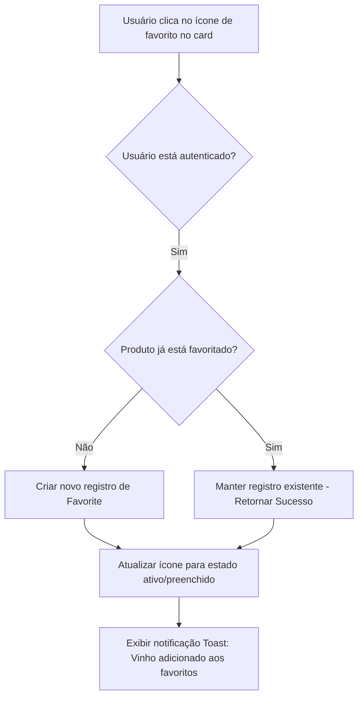
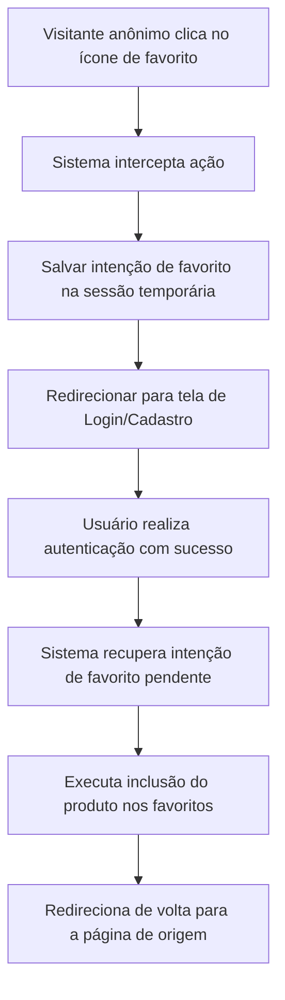
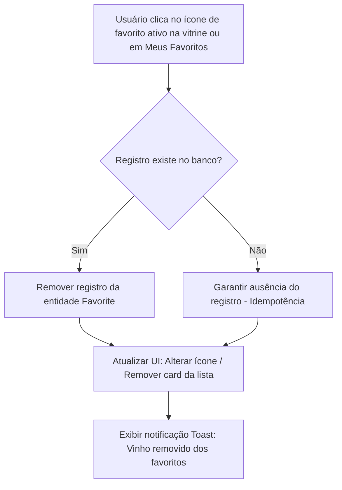
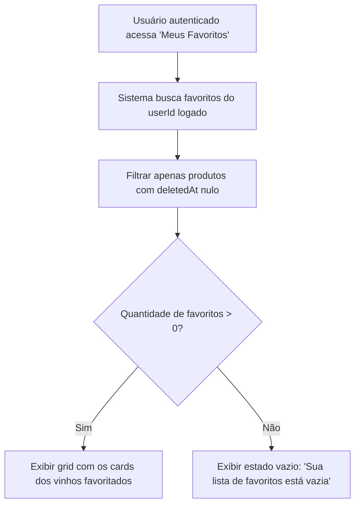

# Especificação Funcional — Domínio de Favoritos (Wishlist)

---

## 1. Objetivo

Definir o comportamento funcional e arquitetural do módulo de **Gerenciamento de Favoritos (Wishlist)** no e-commerce **Origem Vinhos**. 

A funcionalidade permite que usuários autenticados salvem produtos de seu interesse em uma lista pessoal para consulta posterior, de forma totalmente independente do Carrinho de Compras. A marcação de um produto como favorito reflete apenas o interesse ou apreço do cliente pela rotulo, sem representar intenção imediata de compra ou reserva de estoque.

---

## 2. Escopo

Esta especificação contempla:

* Adição de vinhos do catálogo à lista de favoritos do usuário autenticado;
* Remoção individual de vinhos da lista de favoritos;
* Operações idempotentes de adição e remoção de favoritos;
* Indicador visual de status favoritado (`isFavorite`) nos cards do catálogo e detalhes do produto;
* Consulta e listagem dos favoritos na página dedicada **"Meus Favoritos"**;
* Restrição de acesso e controle de autorização baseados na identidade do usuário autenticado;
* Redirecionamento e preservação de intenção para visitantes anônimos que tentam favoritar um item;
* Tratamento automático de integridade referencial quando produtos sofrem exclusão lógica (*soft delete*) no catálogo;
* Remoção automática em cascata dos favoritos associados quando a conta de um usuário é excluída.

---

## 3. Fora de Escopo

Esta especificação **não contempla**:

* Compartilhamento de listas de favoritos via link externo, redes sociais ou e-mail;
* Listas públicas de favoritos ou visibilidade de favoritos entre diferentes usuários;
* Listas colaborativas (múltiplos usuários editando a mesma lista);
* Organização de favoritos em pastas, categorias personalizadas ou coleções temáticas;
* Notificações automáticas de alteração de preço (alerta de queda de preço);
* Notificações de reposição de estoque (alerta de *back in stock*);
* Algoritmos de recomendação baseados na lista de favoritos;
* Histórico de itens desfavoritados ou remoções anteriores;
* Adição direta de todos os itens favoritados ao carrinho em um único clique (*"Mover todos para o carrinho"*).

---

## 4. Modelo de Domínio Conceitual

O domínio de Favoritos estabelece uma relação associativa N:M (muitos-para-muitos) entre o domínio de **Identidade (`User`)** e o domínio de **Catálogo (`Product`)**, modelada através da entidade **`Favorite`**.

### 4.1 Diagrama de Relacionamento (UML)

```
┌────────────────────────────────┐       1:N       ┌────────────────────────────────┐       N:1       ┌────────────────────────────────┐
│             User               ├─────────────────┤            Favorite            ├─────────────────┤            Product             │
├────────────────────────────────┤                 ├────────────────────────────────┤                 ├────────────────────────────────┤
│ - id: UUID                     │                 │ - id: UUID                     │                 │ - id: UUID                     │
│ - name: String                 │                 │ - userId: UUID                 │                 │ - name: String                 │
│ - email: String                │                 │ - productId: UUID              │                 │ - price: Decimal               │
└────────────────────────────────┘                 │ - createdAt: DateTime          │                 │ - deletedAt: DateTime (null)   │
                                                   │ - updatedAt: DateTime          │                 └────────────────────────────────┘
                                                   └────────────────────────────────┘
```

### 4.2 Atributos da Entidade `Favorite`

| Atributo | Tipo de Dado | Obrigatório | Descrição / Restrição |
|---|---|---|---|
| **Identificador (`id`)** | UUID | Sim | Chave primária única gerada automaticamente. |
| **Identificador do Usuário (`userId`)** | UUID | Sim | Chave estrangeira referenciando a conta do usuário proprietário. |
| **Identificador do Produto (`productId`)** | UUID | Sim | Chave estrangeira referenciando o produto cadastrado no catálogo. |
| **Data de Criação (`createdAt`)** | DateTime | Sim | Registro de data e hora em que o produto foi favoritado. |
| **Data de Atualização (`updatedAt`)** | DateTime | Sim | Registro de data e hora da última modificação do registro. |

### 4.3 Restrições de Domínio

1. **Unicidade do Par `(userId, productId)`:** Um mesmo usuário não pode favoritar o mesmo produto mais de uma vez. O par composto por `userId` e `productId` deve ser estritamente único.
2. **Integridade de Identidade:** Um registro de favorito não pode existir sem um `userId` válido e ativo.
3. **Integridade de Catálogo:** Um registro de favorito não pode referenciar um produto inexistente ou que tenha sofrido exclusão lógica (`deletedAt != null`).

---

## 5. Regras de Negócio

### RN-FAV-01: Autenticação Obrigatória
* O gerenciamento de favoritos é um recurso exclusivo para usuários autenticados.
* Visitantes anônimos (não autenticados) podem visualizar o catálogo normalmente, porém não possuem lista de favoritos.
* Se um visitante anônimo clicar no ícone de favorito em qualquer local da plataforma, o sistema deve interceptar a ação, reter o produto selecionado como intenção de favorito e redirecioná-lo para a tela de autenticação (Login/Cadastro).
* Após a autenticação bem-sucedida, o sistema deve efetivar a adição do produto aos favoritos e retornar o usuário à visualização de origem.

### RN-FAV-02: Unicidade e Idempotência na Adição
* A tentativa de adicionar um produto que já consta na lista de favoritos do usuário não deve gerar duplicidade nem retornar erro.
* A operação de **Adicionar Favorito** deve ser **idempotente**: se o produto já estiver favoritado pelo usuário, o sistema deve manter o registro existente e retornar sucesso sem criar novos registros.

### RN-FAV-03: Idempotência na Remoção
* A tentativa de remover um produto que não consta (ou já foi removido) da lista de favoritos do usuário não deve retornar erro.
* A operação de **Remover Favorito** deve ser **idempotente**: caso o registro não exista, o sistema deve garantir que o produto não está na lista e retornar confirmação de sucesso.

### RN-FAV-04: Dinâmica de Interação (Toggle na Vitrine)
* Nos cards de produto do catálogo e na tela de detalhes do vinho, o botão de favorito opera sob o padrão **Toggle**:
  * Se o produto **não** está favoritado pelo usuário logado $\rightarrow$ O ícone é exibido em estado neutro/contorno. O clique dispara a **Adição**.
  * Se o produto **já** está favoritado pelo usuário logado $\rightarrow$ O ícone é exibido em estado ativo/preenchido. O clique dispara a **Remoção**.

### RN-FAV-05: Isolamento Estrito por Usuário
* A lista de favoritos pertence exclusivamente ao usuário autenticado.
* Um usuário nunca pode visualizar, adicionar, alterar ou remover itens da lista de favoritos de outro usuário.
* As requisições de favoritos devem sempre extrair a identidade do usuário a partir da sessão/token autenticado, ignorando qualquer tentativa de manipulação de `userId` via parâmetro externo.

### RN-FAV-06: Tratamento de Produto Removido (*Soft Delete*)
* O catálogo de vinhos utiliza o conceito de exclusão lógica (*soft delete*), onde produtos excluídos por um `Admin` recebem marcação no atributo `deletedAt`.
* Favoritos vinculados a um produto que sofreu exclusão lógica não devem ser exibidos na lista "Meus Favoritos" nem computados nas contagens do usuário.
* A listagem de favoritos deve filtrar ativamente apenas produtos cujo atributo `deletedAt` seja nulo (`isNull(deletedAt)`).
* Caso um produto seja excluído do catálogo, a rotina de exclusão lógica ou o serviço de consulta de favoritos garante a remoção/ocultação imediata do item na lista do cliente.

### RN-FAV-07: Tratamento de Exclusão da Conta de Usuário
* Quando um usuário solicita e confirma a exclusão de sua própria conta (`User`), todos os registros de favoritos associados ao seu `userId` devem ser automaticamente e permanentemente excluídos (*Cascade Delete*).

### RN-FAV-08: Independência Total do Carrinho de Compras
* A lista de favoritos é conceitualmente e operacionalmente dissociada do Carrinho de Compras.
* Favoritar um produto **não** altera o carrinho e **não** reserva unidades no estoque.
* Adicionar um item do catálogo ao Carrinho **não** remove o produto da lista de favoritos do usuário.
* O usuário pode manter o produto na lista de favoritos mesmo após efetuar a compra do item.

---

## 6. Fluxos Operacionais

### 6.1 Fluxo: Adicionar Produto aos Favoritos (Usuário Autenticado)



### 6.2 Fluxo: Intercepção para Usuário Anônimo (Não Autenticado)



### 6.3 Fluxo: Remover Produto dos Favoritos



### 6.4 Fluxo: Visualização da Página "Meus Favoritos"



---

## 7. Critérios de Aceite (BDD / Gherkin)

### Cenário 1: Adicionar produto aos favoritos com sucesso (Fluxo Feliz)
```gherkin
Dado que o usuário "Ana" está autenticada na plataforma
E está navegando pelo catálogo de vinhos
E o vinho "Château Margaux 2015" não está na sua lista de favoritos
Quando a usuária clicar no ícone de favorito do "Château Margaux 2015"
Então o sistema deve registrar o vinho na lista de favoritos da usuária "Ana"
E o ícone de favorito do card deve mudar para o estado ativo
E o sistema deve exibir uma notificação toast "Vinho adicionado aos seus favoritos".
```

### Cenário 2: Alternar estado para remover produto dos favoritos (Toggle / Fluxo Feliz)
```gherkin
Dado que o usuário "Carlos" está autenticado na plataforma
E o vinho "Chablis Premier Cru 2020" já está na sua lista de favoritos
E o ícone de favorito é exibido no estado ativo no card do produto
Quando o usuário clicar no ícone de favorito do "Chablis Premier Cru 2020"
Então o sistema deve remover o vinho da lista de favoritos do usuário "Carlos"
E o ícone de favorito deve retornar ao estado neutro
E o sistema deve exibir uma notificação toast "Vinho removido dos seus favoritos".
```

### Cenário 3: Tentativa de favoritar por visitante anônimo (Fluxo Alternativo)
```gherkin
Dado que um visitante não está autenticado na plataforma
Quando ele clicar no ícone de favorito de qualquer vinho no catálogo
Então o sistema deve interceptar a ação e salvar a intenção do produto
E deve redirecionar o visitante para a tela de autenticação
E após o visitante realizar o login com sucesso
Então o sistema deve adicionar automaticamente o vinho selecionado aos seus favoritos
E redirecionar o usuário de volta à página do catálogo.
```

### Cenário 4: Idempotência na adição duplicada (Caso de Borda / API)
```gherkin
Dado que o usuário "Lucas" já possui o vinho "Cave Geisse Terroir Brut" em seus favoritos
Quando uma requisição de adição deste mesmo vinho for enviada repetidamente para o sistema
Então o sistema não deve criar registros duplicados na tabela de favoritos
E deve retornar uma resposta de sucesso (HTTP 200/201) confirmando a presença do item nos favoritos.
```

### Cenário 5: Idempotência na remoção de item já removido (Caso de Borda / API)
```gherkin
Dado que o vinho "Casillero del Diablo" não consta na lista de favoritos do usuário "Lucas"
Quando uma requisição de exclusão deste item for enviada para o sistema
Então o sistema não deve retornar erro de item não encontrado (HTTP 404)
E deve retornar confirmação de sucesso garantindo que o item não está presente na lista.
```

### Cenário 6: Produto favoritado sofre exclusão lógica pelo Admin (Caso de Exceção)
```gherkin
Dado que o usuário "Mariana" possui o vinho "Castaño Monastrell Rosado" em seus favoritos
E um administrador realiza a exclusão lógica (soft delete) deste vinho no catálogo
Quando a usuária "Mariana" acessar a página "Meus Favoritos"
Então o vinho excluído não deve ser exibido na sua lista de favoritos
E o contador total de favoritos da usuária deve refletir apenas os produtos ativos.
```

### Cenário 7: Exclusão da conta do usuário limpa os favoritos (Caso de Exceção)
```gherkin
Dado que o usuário "Roberto" possui 5 vinhos em sua lista de favoritos
Quando o usuário "Roberto" solicitar e confirmar a exclusão da sua conta
Então a conta do usuário deve ser removida do sistema
E todos os 5 registros de favoritos associados ao seu ID devem ser excluídos permanentemente.
```

### Cenário 8: Visualização de lista de favoritos vazia (Fluxo Alternativo)
```gherkin
Dado que a usuária "Fernanda" está autenticada
E não possui nenhum vinho adicionado à sua lista de favoritos
Quando ela navegar para a página "Meus Favoritos"
Então o sistema deve exibir uma tela de estado vazio com a mensagem "Sua adega de favoritos está vazia"
E um botão convidativo "Explorar Catálogo" direcionando para a vitrine principal.
```

---

## 8. Requisitos Não Funcionais

### 8.1 Performance
* A consulta e alteração do status de favorito de um produto deve responder em tempo inferior a **100ms** em condições normais de carga.
* A listagem de favoritos na página "Meus Favoritos" deve utilizar consultas otimizadas com *joins* diretos entre as tabelas `Favorite` e `Product`.

### 8.2 Segurança e Autorização
* Todas as rotas e operações do domínio de Favoritos exigem autenticação válida via token de sessão.
* As operações de leitura e escrita devem ser estritamente escopadas ao `userId` extraído da sessão autenticada.
* O sistema deve prevenir ataques de referência direta a objetos inseguros (IDOR), impedindo que um usuário passe o `userId` de terceiros nas requisições.

### 8.3 Integridade e Consistência
* O banco de dados deve impor restrição de chave única composta no par `(userId, productId)` (`UNIQUE INDEX`).
* Exclusões físicas de usuários devem acionar *Cascade Delete* na tabela de favoritos.

### 8.4 Desacoplamento e Baixo Acoplamento
* O domínio de Favoritos não deve possuir dependência direta com o domínio de Carrinho (`Cart`) nem com o domínio de Pedidos (`Orders`).
* O domínio depende exclusivamente das abstrações de contrato dos domínios de `Identity` (para validação do usuário) e `Catalog` (para resolução do produto).

---

## 9. Arquitetura e Estruturação de Camadas

A implementação do domínio de Favoritos segue rigorosamente os princípios de **Clean Architecture**, **SOLID** e **Vertical Slices**:

```
/src/domains/favorites
  ├── domain/
  │   ├── favorite.entity.ts       (Regras de negócio puras e invariantes da entidade)
  │   └── favorite.repository.ts   (Interface/Port do repositório)
  ├── application/
  │   ├── add-favorite.usecase.ts  (Caso de uso: Adicionar aos favoritos)
  │   ├── remove-favorite.usecase.ts (Caso de uso: Remover dos favoritos)
  │   ├── list-favorites.usecase.ts (Caso de uso: Listar favoritos do usuário)
  │   └── check-favorite.usecase.ts (Caso de uso: Verificar status do produto)
  ├── infra/
  │   ├── favorites.repository.drizzle.ts (Adapter concreto Drizzle ORM)
  │   └── favorites.schema.ts      (Declaração da tabela e índices no Postgres)
  └── interface/
      ├── favorites.handlers.ts    (Handlers de rotas HTTP / Controller API)
      └── favorites.component.tsx  (Componentes UI React para favoritos)
```

---

## 10. Impactos em Specs Existentes

A introdução desta especificação requer atualizações menores nas seguintes especificações do projeto:

1. **`docs/prd_v1.md`**:
   * Atualização da Seção 3 (Funcionalidades) para incluir o módulo **3.6. Gestão de Favoritos (Wishlist)**.
   * Ajuste da Seção 8.3 (Fora de Escopo) removendo "lista de favoritos" da lista de itens excluídos da V1.
2. **`docs/specs/spec01-CRUD-User.md`**:
   * Atualização da Seção 2 (Escopo) e Seção 4 (Regras de Negócio - Customer) incluindo o direito do usuário de gerenciar sua lista pessoal de favoritos.
   * Adição do relacionamento 1:N entre `User` e `Favorite` na especificação de dados do usuário.
3. **`docs/specs/spec02-CRUD-Catalogo.md`**:
   * Atualização da Seção 2 (Escopo - Não contempla) removendo o item "Lista de vinhos favoritos".
   * Adição da regra de exibição do status de favorito (`isFavorite`) no card de produto da vitrine.

---

## 11. Casos Futuros (Evolução Natural)

Funcionalidades que poderão evoluir naturalmente a partir desta especificação em versões subsequentes da plataforma:

1. **Wishlist Compartilhável:** Permitir que usuários gerem um link público único para compartilhar sua seleção de favoritos com amigos ou em listas de presentes.
2. **Coleções Temáticas de Favoritos:** Possibilidade de organizar favoritos em pastas personalizadas (ex: *"Vinhos para o Inverno"*, *"Jantares Especiais"*, *"Favoritos do Casal"*).
3. **Alertas de Promoção / Queda de Preço:** Notificar por e-mail ou push o usuário quando um produto presente em seus favoritos receber um desconto no valor de venda.
4. **Alerta de Reposição de Estoque:** Enviar aviso automático quando um rótulo favorito que estava indisponível retornar ao estoque.
5. **Recomendações Personalizadas:** Utilizar os atributos dos vinhos favoritados (tipos de uva, países de origem preferidos) para sugerir novos rótulos semelhantes na vitrine.

---

## 12. Autoavaliação da Spec

### Nota de Avaliação: **10 / 10**

### Justificativa da Nota
* **Completude:** Todos os tópicos exigidos pela diretiva do projeto foram cobertos com riqueza de detalhes (Domínio, Regras de Negócio, Fluxos com Mermaid, Cenários BDD Gherkin, RNF, Clean Architecture, Impactos e Casos Futuros).
* **Consistência e Alinhamento:** O documento respeita 100% as decisões técnicas tomadas durante a fase de alinhamento (tratamento de *soft delete*, intercepção de anônimos, ação de *toggle* idempotente).
* **Ausência de Código de Implementação:** A spec define *o quê* e *como* sob a perspectiva funcional e arquitetural sem engessar detalhes de implementação concreta (sem trechos de rotas express/bun ou SQL direto), preservando a pureza de uma Especificação Funcional Enterprise.

### Pontos para Decisão Técnica na Fase de Implementação (Handover)
1. **Duração e Armazenamento da Intenção de Anônimo:** Definir no Frontend React se a intenção de favorito de um visitante não logado deve ser mantida em `localStorage` ou `sessionStorage` antes de redirecionar para a página `/login`.
