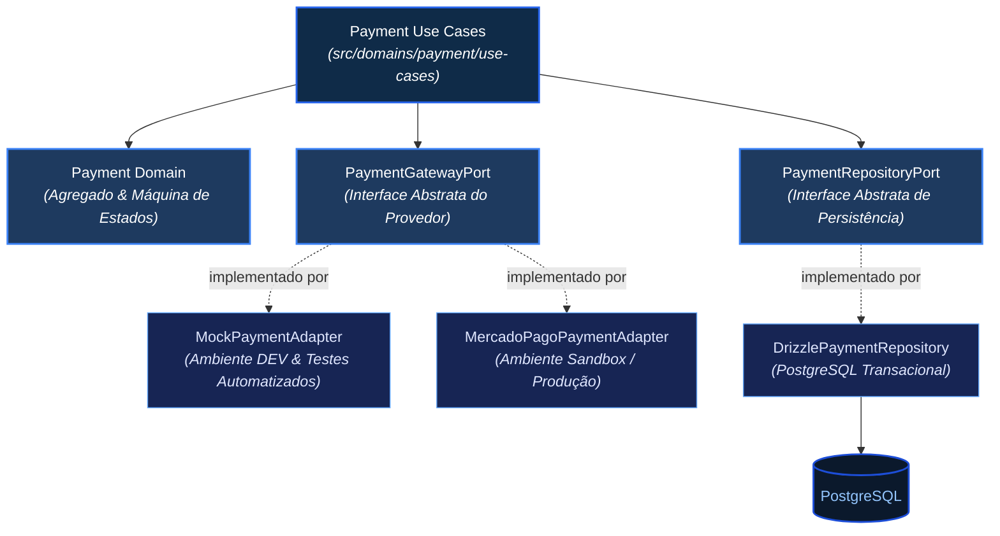
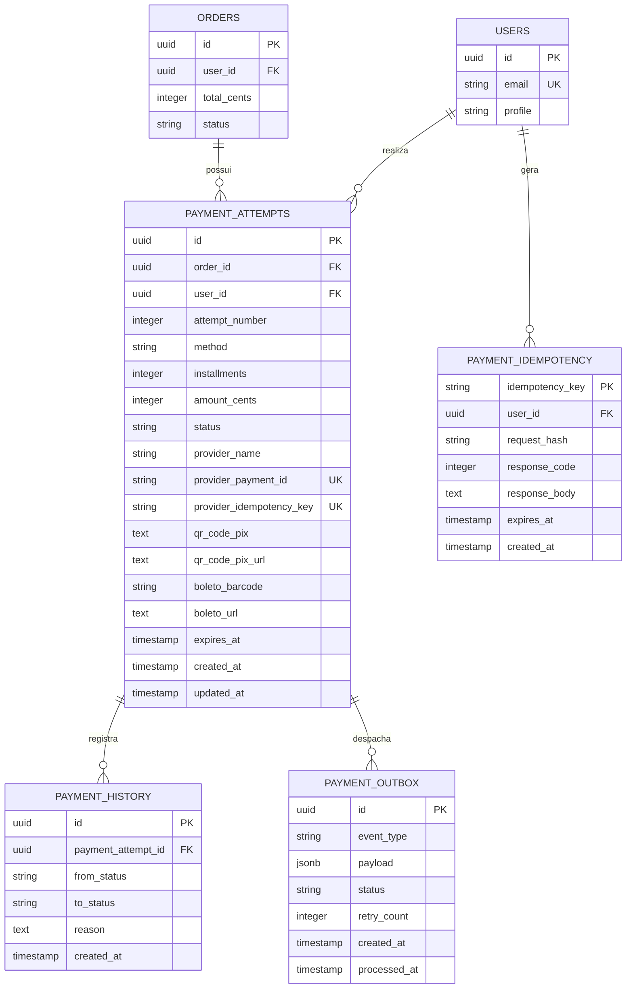
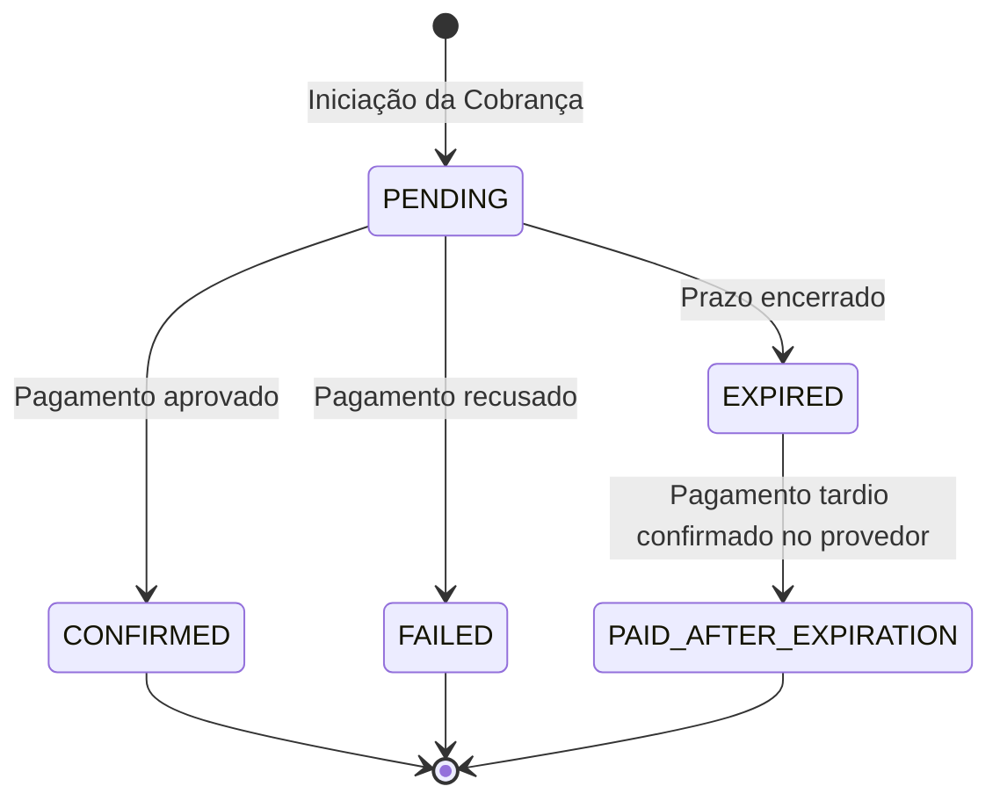
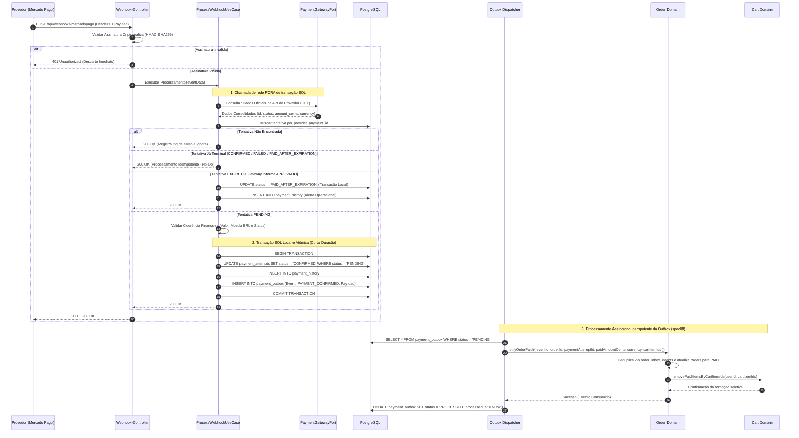
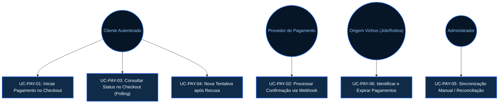

# Especificação Funcional e Arquitetural — Módulo de Pagamento (`spec07`)

---

## 1. Objetivo e Contexto

Definir formalmente o comportamento funcional, regras de negócio, modelagem de dados, máquina de estados, garantias transacionais e contratos de integração do **Módulo de Pagamento** (`Payment`) do e-commerce **Origem Vinhos**.

Esta especificação estabelece um bounded context financeiro autônomo, transacionalmente seguro e desacoplado de provedores externos, fundamentado no estilo de **Arquitetura Hexagonal (Ports & Adapters)** definido em `docs/infra.md`. O módulo contempla a orquestração de pagamentos para o mercado brasileiro nas modalidades **Cartão de Crédito à Vista**, **Cartão de Crédito Parcelado**, **Pix Dinâmico** e **Boleto Bancário**, operando via interface de *checkout embutido* (transparente) no frontend React.

---

## 2. Escopo do Módulo

### 2.1 O que esta especificação contempla
* **Iniciação de Cobrança no Checkout:** Processamento da intenção de pagamento disparada a partir da tela de Checkout (`Checkout.tsx`) após validação compulsória de endereço de entrega ([spec05-ViaCEP-Endereco.md](./spec05-ViaCEP-Endereco.md)).
* **Cálculo Financeiro Soberano no Servidor:** Cálculo imutável do valor total exigido a partir do snapshot dos itens vinculados ao pedido e preços vigentes no catálogo ([spec02-CRUD-Catalogo.md](./spec02-CRUD-Catalogo.md)), expresso exclusivamente em centavos inteiros (`INTEGER`).
* **Meios de Pagamento Suportados:**
  * **Cartão de Crédito (à vista ou parcelado):** Processamento com tokenização estrita no cliente (browser) via SDK do provedor (`card_token`), sem trânsito de dados sensíveis pelo backend.
  * **Pix Dinâmico:** Geração de payload "Copia e Cola" e imagem de QR Code com prazo de expiração configurado formalmente para **30 minutos**, atendendo à restrição técnica obrigatória da API do Mercado Pago (`date_of_expiration`).
  * **Boleto Bancário:** Geração de linha digitável e URL oficial para impressão com vencimento parametrizado para **3 dias úteis**.
* **Tentativas Isoladas de Pagamento (`PaymentAttempt`):** Cada submissão ao provedor constitui uma entidade única e rastreável. Falhas ou recusas anteriores não contaminam nem sobrescrevem tentativas subsequentes.
* **Persistência Prévia e Idempotência:** Gravação em banco da intenção no estado preliminar antes do disparo HTTP ao gateway externo, com suporte a chaves de idempotência da API e do provedor para recuperação de falhas de rede.
* **Máquina de Estados Concorrente:** Ciclo de vida determinístico com transições atômicas condicionais, isolando estados terminais (`CONFIRMED`, `FAILED`, `EXPIRED`) e tratando pagamentos tardios via estado de exceção (`PAID_AFTER_EXPIRATION`).
* **Consistência Confiável entre Pagamento, Pedido e Carrinho (Padrão Transactional Outbox):** A confirmação de pagamento grava atomicamente no PostgreSQL um evento na tabela `payment_outbox`. Um worker desacoplado e idempotente consome essa outbox para atualizar o pedido para pago e executar a remoção seletiva dos itens pagos no carrinho, prevenindo que falhas transitórias deixem o sistema em estado inconsistente.
* **Duplo Adaptador de Gateway:**
  * **Provedor Simulado (`MockPaymentAdapter`):** Implementação local em memória para desenvolvimento ágil e testes automatizados (`bun test`) com custo zero e sem dependência de rede.
  * **Provedor de Referência (`MercadoPagoPaymentAdapter`):** Implementação concreta para ambiente Sandbox, viabilizando testes de integração com contas de Pessoa Física (CPF).
* **Trilha de Auditoria Imutável:** Registro cronológico de todas as transições de status com carimbo de tempo UTC e justificativa técnica.

### 2.2 O que NÃO contempla (Fora de Escopo da V1)
* **Gestão de Estornos e Devoluções (Refunds):** Fluxos de cancelamento pós-aprovação e devolução monetária pertencem a fases futuras de pós-venda.
* **Cálculo Ativo e Tarifação de Frete:** Conforme o `docs/prd_v1.md`, o cálculo dinâmico de frete está fora de escopo, sendo declarado como **Frete Grátis (R$ 0,00)** nesta versão.
* **Envio de E-mails Transacionais:** Notificações externas via SMTP/mensageria ficam delegadas à futura especificação de notificações.
* **Reserva Ativa de Estoque Físico:** Produtos continuam com estoque tratado como infinito até a implementação do módulo de inventário.
* **Armazenamento de Dados de Cartão:** A plataforma nunca recebe, trafega ou persiste números de cartão (PAN) ou códigos de segurança (CVV).

---

## 3. Glossário e Conceitos Fundamentais

* **Centavos Inteiros (`amount_cents`):** Representação monetária multiplicada por 100 (ex: R$ 149,90 = `14990`). Elimina imprecisões de arredondamento inerentes a números de ponto flutuante binário (IEEE 754).
* **Idempotência:** Garantia de que uma requisição submetida repetidas vezes produz exatamente o mesmo efeito da primeira execução, prevenindo cobranças duplicadas.
* **Transactional Outbox:** Padrão arquitetural em que eventos de domínio destinados a outros módulos (como Pedidos e Carrinho) são persistidos na mesma transação SQL local do pagamento, garantindo entrega confiável (*at-least-once*) por um despachante assíncrono.
* **Token de Pagamento (`card_token`):** Hash criptográfico efêmero gerado pelo provedor de pagamento diretamente no browser do cliente para representar os dados do cartão de forma segura.
* **Tentativa de Pagamento (`PaymentAttempt`):** Registro individual de uma submissão de cobrança ao gateway. Um pedido pode acumular múltiplas tentativas sequenciais caso ocorram recusas operacionais.
* **Webhook:** Callback HTTP assíncrono disparado pelo gateway financeiro para a API da Origem Vinhos para notificar mudanças de estado financeiro.
* **Reconciliação:** Procedimento síncrono ou periódico de consulta direta à API do gateway para sincronizar o estado da cobrança quando webhooks sofrem atraso ou perda.
* **Polling Suave:** Consultas repetidas em intervalo controlado (3 a 5 segundos) efetuadas pela interface enquanto exibe QR Code Pix ou Boleto.

---

## 4. Atores e Permissões

| Ator | Tipo | Responsabilidades e Limites de Acesso |
| :--- | :--- | :--- |
| **Cliente Autenticado** | Usuário (`Customer`) | Pode submeter pagamento para seus próprios pedidos, consultar o status da tentativa e realizar nova tentativa se houver recusa. Bloqueado de consultar dados de outros usuários (Anti-IDOR). |
| **Provedor de Pagamento (PSP)** | Sistema Externo | Notifica a plataforma via webhooks criptograficamente assinados sobre aprovações, recusas ou alterações financeiras. |
| **Sistema (Rotina Interna / Worker Outbox)** | Processo Automático | Identifica tentativas pendentes com tempo limite expirado (`expires_at < NOW()`), processa reconciliações pendentes e despacha eventos da `payment_outbox` de forma confiável. |
| **Administrador** | Usuário (`Admin`) | Pode inspecionar a trilha de auditoria de qualquer pagamento, disparar reconciliação síncrona manual e tratar pendências operacionais de pagamentos tardios (`PAID_AFTER_EXPIRATION`). |

---

## 5. Arquitetura do Domínio de Pagamento

Seguindo o `docs/infra.md`, o módulo localiza-se em `src/domains/payment/`. O núcleo de aplicação e regras de negócio comunica-se exclusivamente através de interfaces (**Ports**), permanecendo 100% desacoplado de bibliotecas de terceiros ou ORMs específicos.



---

## 6. Modelagem de Dados e Entidades

O modelo relacional do PostgreSQL é gerenciado via **Drizzle ORM** em `src/infra/schema.ts`, projetado com integridade referencial estrita, índices de alta performance e fusos horários padronizados em UTC.

### 6.1 Diagrama Entidade-Relacionamento (ERD)



### 6.2 Especificação Detalhada das Tabelas

#### Tabela `payment_attempts` (Tentativas de Pagamento)
Representa cada ciclo de submissão financeira junto ao gateway. Permite rastrear tentativas falhas sem destruir o vínculo com o pedido.

| Coluna | Tipo Drizzle / SQL | Restrições | Regra / Semântica |
| :--- | :--- | :--- | :--- |
| `id` | `uuid` | PK, `defaultRandom()` | Identificador universal e imutável da tentativa de pagamento. |
| `order_id` | `uuid` | NOT NULL, Index | Vínculo com o pedido correspondente (`spec08`). Chave lógica até a migração física de `orders`. |
| `user_id` | `uuid` | NOT NULL, FK `users.id` | Identificador do pagador (extraído da sessão autenticada, proteção IDOR). |
| `attempt_number` | `integer` | NOT NULL, Default `1` | Número sequencial da tentativa para aquele `order_id` específico. |
| `method` | `varchar(20)` | NOT NULL | Enum: `'CREDIT_CARD'`, `'PIX'`, `'BOLETO'`. |
| `installments` | `integer` | NOT NULL, Default `1` | Quantidade de parcelas (1 para Pix/Boleto; 1 a 12 para Cartão). |
| `amount_cents` | `integer` | NOT NULL | Montante total em centavos inteiros (deve ser estritamente > 0). |
| `status` | `varchar(30)` | NOT NULL, Default `'PENDING'` | Estado: `'PENDING'`, `'CONFIRMED'`, `'FAILED'`, `'EXPIRED'`, `'PAID_AFTER_EXPIRATION'`. |
| `provider_name` | `varchar(30)` | NOT NULL | Identificador do adaptador utilizado (`'mock'`, `'mercadopago'`). |
| `provider_payment_id`| `varchar(100)` | Nullable, Unique Index | ID oficial da transação atribuído pelo gateway externo. |
| `provider_idempotency_key` | `varchar(120)` | NOT NULL, Unique Index | Chave de idempotência enviada ao provedor externo para prevenir duplicidade no gateway. |
| `qr_code_pix` | `text` | Nullable | String do código Pix "Copia e Cola" (quando `method = 'PIX'`). |
| `qr_code_pix_url` | `text` | Nullable | URL ou Base64 da imagem do QR Code Pix. |
| `boleto_barcode` | `varchar(100)` | Nullable | Linha digitável numérica do boleto bancário (47 ou 48 dígitos). |
| `boleto_url` | `text` | Nullable | URL pública fornecida pelo provedor para visualização/impressão do boleto. |
| `expires_at` | `timestamp` | NOT NULL | Timestamp limite UTC para a conclusão válida do pagamento (**30 minutos** para Pix; **3 dias úteis** para Boleto). |
| `created_at` | `timestamp` | NOT NULL, Default `now()` | Timestamp UTC de criação da tentativa no banco local. |
| `updated_at` | `timestamp` | NOT NULL, Default `now()` | Timestamp UTC da última atualização de estado. |

*Índices Obrigatórios:*
- `payment_attempts_provider_idx`: Índice único parcial em `provider_payment_id` (onde `provider_payment_id IS NOT NULL`).
- `payment_attempts_order_attempt_idx`: Índice composto único em `(order_id, attempt_number)`.
- `payment_attempts_status_expires_idx`: Índice composto em `(status, expires_at)` para otimização de varreduras de expiração.

#### Tabela `payment_history` (Trilha de Auditoria Imutável)
Tabela restrita a operações de inserção (*append-only*), proibindo terminantemente `UPDATE` ou `DELETE`.

| Coluna | Tipo | Restrições | Regra / Semântica |
| :--- | :--- | :--- | :--- |
| `id` | `uuid` | PK, `defaultRandom()` | Identificador universal do evento de auditoria. |
| `payment_attempt_id`| `uuid` | NOT NULL, FK `payment_attempts.id` | Vínculo com a tentativa auditada. |
| `from_status` | `varchar(30)`| Nullable | Estado de origem (nulo apenas no registro de criação inicial). |
| `to_status` | `varchar(30)`| NOT NULL | Novo estado atribuído à tentativa. |
| `reason` | `text` | NOT NULL | Motivo técnico/operacional detalhado (ex: *"Aprovação confirmada via Webhook Mercado Pago"*, *"Timeout 30min atingido"*). |
| `created_at` | `timestamp` | NOT NULL, Default `now()` | Timestamp UTC exato da ocorrência do evento. |

#### Tabela `payment_outbox` (Padrão Transactional Outbox)
Garante a comunicação assíncrona confiável e atômica com o domínio de Pedidos e Carrinho.

| Coluna | Tipo | Restrições | Regra / Semântica |
| :--- | :--- | :--- | :--- |
| `id` | `uuid` | PK, `defaultRandom()` | Identificador do evento na fila transacional. |
| `event_type` | `varchar(50)` | NOT NULL | Tipo do evento: `'PAYMENT_CONFIRMED'`, `'PAYMENT_EXPIRED'`, `'PAYMENT_FAILED'`. |
| `payload` | `jsonb` | NOT NULL | Dados estruturados: `orderId`, `paymentAttemptId`, `userId`, `amountCents`, `orderItemIds`. |
| `status` | `varchar(20)` | NOT NULL, Default `'PENDING'` | Estado do despacho: `'PENDING'`, `'PROCESSING'`, `'PROCESSED'`, `'FAILED'`. |
| `retry_count` | `integer` | NOT NULL, Default `0` | Quantidade de tentativas de envio executadas pelo despachante. |
| `created_at` | `timestamp` | NOT NULL, Default `now()` | Timestamp UTC de inserção (mesma transação SQL do pagamento). |
| `processed_at`| `timestamp` | Nullable | Timestamp UTC da conclusão bem-sucedida do processamento consumidor. |

*Índice Obrigatório:* `payment_outbox_pending_idx`: Índice parcial em `(status, created_at)` onde `status = 'PENDING'`.

#### Tabela `payment_idempotency` (Controle de Idempotência da API)
Garante o tratamento de requisições repetidas na borda HTTP da aplicação.

| Coluna | Tipo | Restrições | Regra / Semântica |
| :--- | :--- | :--- | :--- |
| `idempotency_key` | `varchar(120)` | PK | Chave única fornecida pelo cliente no cabeçalho `Idempotency-Key`. |
| `user_id` | `uuid` | NOT NULL, FK `users.id` | Identificador do usuário solicitante (proteção contra roubo de chave). |
| `request_hash` | `varchar(64)` | NOT NULL | Hash criptográfico SHA-256 do corpo JSON da requisição. |
| `response_code` | `integer` | Nullable | Código HTTP de retorno (ex: 201, 400). Nulo enquanto a requisição estiver em processamento. |
| `response_body` | `text` | Nullable | Payload JSON da resposta a ser reenviada em chamadas idênticas. |
| `expires_at` | `timestamp` | NOT NULL | Timestamp UTC de expiração do registro de idempotência (**24 horas** após a criação). |
| `created_at` | `timestamp` | NOT NULL, Default `now()` | Timestamp UTC de criação da chave. |

---

## 7. Máquina de Estados e Ciclo de Vida

O ciclo de vida da tentativa de pagamento é governado por regras determinísticas estritas. Estados terminais não admitem transições arbitrárias.

### 7.1 Diagrama Formal de Estados



### 7.2 Tabela Formal de Transições

| Estado Origem | Evento / Gatilho | Condições Prévias Obrigatórias | Estado Destino | Efeitos de Negócio Associados |
| :--- | :--- | :--- | :--- | :--- |
| `(Início)` | Iniciar Pagamento | Itens válidos no pedido, snapshot de preço fixado, total em centavos validado no servidor, endereço selecionado. | `PENDING` | Registro prévio em `payment_attempts`, persistência da chave de idempotência do provedor, chamada ao gateway, inserção na auditoria. |
| `PENDING` | Aprovação Financeira | Assinatura válida de webhook ou consulta oficial, `amount_cents` exato, moeda coincidente, `provider_payment_id` vinculado. | `CONFIRMED` | **1.** Atualização atômica para `CONFIRMED`.<br>**2.** Registro em `payment_history`.<br>**3.** Gravação atômica do evento `'PAYMENT_CONFIRMED'` na `payment_outbox`.<br>**4.** Notificação assíncrona ao consumidor outbox para aprovar o pedido e esvaziar os itens pagos do carrinho. |
| `PENDING` | Recusa Financeira | Retorno definitivo de rejeição pelo provedor (ex: saldo insuficiente, cartão expirado, antifraude reprovado). | `FAILED` | Marcação de `FAILED`, registro do motivo na auditoria, liberação na interface para nova tentativa (`attempt_number + 1`) sem cancelar o pedido imediatamente. |
| `PENDING` | Encerramento de Prazo | Timestamp UTC atual `now() > expires_at` sem confirmação financeira registrada. | `EXPIRED` | Marcação de `EXPIRED`, gravação do evento `'PAYMENT_EXPIRED'` na `payment_outbox` para cancelamento assíncrono do pedido, registro na auditoria. |
| `EXPIRED` | Webhook de Aprovação Tardia | Notificação oficial de pagamento aprovado no gateway referente a uma tentativa expirada localmente. | `PAID_AFTER_EXPIRATION` | **1.** Marcação de estado de exceção `PAID_AFTER_EXPIRATION`.<br>**2.** O pedido permanece cancelado (não aprova automaticamente pedido com estoque/preço vencido).<br>**3.** Registro de alerta crítico na auditoria para ação operacional/reembolso administrativo. |
| `CONFIRMED` | Qualquer notificação | Tentativa já em estado terminal aprovado. | *(Bloqueado)* | Operação descartada de forma idempotente. Resposta HTTP 200 ao gateway sem disparar novos efeitos. |
| `FAILED` | Notificação de sucesso tardia | Proibida transição direta de `FAILED` para `CONFIRMED`. | *(Bloqueado)* | Registra evento de inconsistência na auditoria. Não altera o estado da tentativa falha. |

### 7.3 Isolamento entre Múltiplas Tentativas
Se um cliente tem o cartão recusado (`FAILED`) e decide pagar com outro cartão ou via Pix:
1. A tentativa original permanece permanentemente com status `FAILED`.
2. O sistema gera uma nova linha na tabela `payment_attempts` com `attempt_number = 2` e status inicial `PENDING`.
3. Eventos assíncronos ou retentativas de webhook referentes à tentativa 1 são associados exclusivamente à tentativa 1 por meio do `provider_payment_id`, impedindo que um evento tardio da tentativa 1 confirme ou interfira na tentativa 2.

---

## 8. Concorrência, Idempotência e Webhooks

### 8.1 Transições Atômicas Condicionais
Para prevenir condições de corrida (*race conditions*) entre múltiplos callbacks do gateway ou consultas simultâneas da tela (polling), a transição para `CONFIRMED` é realizada mediante comando SQL condicional atômico:

```sql
UPDATE payment_attempts
SET status = 'CONFIRMED',
    updated_at = NOW()
WHERE id = :attemptId AND status = 'PENDING';
```
Se a instrução retornar `0` linhas afetadas, a aplicação constata que a transição já foi processada por outra thread concorrente, aborta os efeitos colaterais e responde com sucesso idempotente (`200 OK`).

### 8.2 Separação de Transações SQL e Chamadas Externas
**Regra Arquitetural Absoluta:** Nenhuma chamada HTTP a provedores externos (Mercado Pago) pode ser executada dentro de uma transação de banco de dados aberta (`BEGIN ... COMMIT`).
* *Racional:* Chamadas externas possuem latência de rede imprevisível (1 a 10 segundos). Manter conexões do PostgreSQL abertas durante tráfego de rede satura o pool de conexões do servidor e trava tabelas por bloqueios de concorrência.
* *Solução:* A chamada ao gateway ocorre fora de qualquer transação SQL. Após obter a resposta do provedor, abre-se uma transação SQL estritamente local e veloz (duração < 10ms) para persistir o estado, o histórico e a mensagem na tabela `payment_outbox`.

### 8.3 Diagrama de Sequência: Processamento Seguro de Webhook com Transactional Outbox

O processamento divide-se rigorosamente em três etapas: validação externa, persistência atômica da outbox e despacho assíncrono idempotente:



### 8.4 Recuperação de Cobranças após Falhas e Idempotência Externa
Se a aplicação submeter uma cobrança ao provedor e sofrer timeout de rede ou crash antes de salvar a resposta localmente:
1. **Persistência Prévia da Intenção:** Antes da chamada HTTP, a tentativa é salva com `status = 'PENDING'` e uma `provider_idempotency_key` única (UUIDv4) gerada localmente.
2. **Envio da Chave de Idempotência ao Gateway:** A chave gerada é enviada no cabeçalho do gateway (cabeçalho `X-Idempotency-Key` na API do Mercado Pago).
3. **Mecanismo de Retentativa Seguro:** Em caso de erro 5xx ou timeout, novas chamadas com a mesma chave retornarão a cobrança originalmente criada pelo gateway sem duplicar transações.
4. **Reconciliação Automática:** Se o processo morrer antes do retorno, o Webhook subsequente do provedor ou o Job de reconciliação localizará a tentativa pela chave de idempotência e resolverá a pendência financeira.

### 8.5 Esvaziamento Seletivo do Carrinho
Para não punir o cliente que continuou navegando e adicionou novos vinhos ao carrinho enquanto um pagamento Pix estava pendente:
* O use-case de confirmação financeira **não** executa `clearCart(userId)`.
* O consumidor assíncrono da outbox lê o snapshot de itens gravados no payload do evento e aciona o repositório do carrinho (`cart.repository.ts`) para remover pontualmente os itens correspondentes:
  ```typescript
  // Remoção pontual dos produtos que compuseram o pedido pago
  await cartRepository.removeMultipleItems(orderProductItemIds);
  ```
* Se o cliente colocou novas garrafas no carrinho após o checkout, esses novos itens permanecem intactos.

---

## 9. Casos de Uso Detalhados



---

### UC-PAY-01: Iniciar Pagamento no Checkout
* **Ator Principal:** Cliente Autenticado.
* **Gatilho:** Cliente seleciona o meio de pagamento na tela de Checkout e clica em "Finalizar Compra".
* **Pré-condições:**
  1. Usuário autenticado na plataforma (sessão ativa comprovada pelo cookie `session_token`).
  2. Pedido criado no estado `PENDING` com snapshot de itens e endereço fixado.
  3. Header `Idempotency-Key` presente na requisição HTTP.
* **Fluxo Principal:**
  1. Cliente envia `POST /api/payments` com o payload de pagamento.
  2. Sistema verifica a chave em `payment_idempotency`. Se já processada, retorna a resposta em cache com o código original. Se em andamento concorrente, responde HTTP `409 Conflict`.
  3. Sistema valida o valor: recalcula a soma dos itens do pedido com base nos preços vigentes no catálogo oficial. O valor do cliente no payload é ignorado; assume-se o valor recalculado em centavos (`amount_cents`). O frete é registrado como R$ 0,00.
  4. Sistema gera uma `provider_idempotency_key` e insere o registro em `payment_attempts` com status `PENDING` e `attempt_number = 1`.
  5. Sistema invoca `PaymentGatewayPort.createPayment(...)` transmitindo os dados da transação.
  6. O gateway responde com sucesso, retornando o `provider_payment_id` e os dados de liquidação:
     * *Cartão:* Confirmação imediata ou pendência antifraude.
     * *Pix:* Código Copia e Cola, URL/Base64 do QR Code e TTL de **30 minutos** (`date_of_expiration`).
     * *Boleto:* Linha digitável, URL do PDF e vencimento em **3 dias úteis**.
  7. Sistema atualiza o registro em `payment_attempts` com o `provider_payment_id` e insere o marco em `payment_history`.
  8. Sistema grava o payload de resposta na tabela `payment_idempotency`.
  9. Sistema responde HTTP `201 Created` com os dados necessários para o cliente visualizar a cobrança.
* **Fluxos Alternativos:**
  * **FA-01 (Cartão Aprovado Imediatamente):** Se o gateway responder com aprovação síncrona instantânea, o sistema executa a transição atômica para `CONFIRMED`, grava o evento na outbox, que despacha a aprovação do pedido e o esvaziamento seletivo do carrinho, respondendo status `CONFIRMED`.
  * **FA-02 (Recusa Imediata de Cartão):** O gateway rejeita a cobrança na chamada síncrona. O sistema transita a tentativa para `FAILED`, registra o motivo da recusa na auditoria e responde HTTP `422 Unprocessable Entity` detalhando o erro sem cancelar o pedido.
* **Exceções:**
  * **FE-01 (Indisponibilidade do Provedor):** Falha de rede ou timeout na API externa. O sistema responde HTTP `502 Bad Gateway`. A tentativa local permanece gravada como `PENDING` para futura reconciliação sem duplicação de cobrança.
  * **FE-02 (Violação de Idempotência):** Mesma chave enviada com payload divergente (SHA-256 mismatch). O sistema rejeita com HTTP `409 Conflict`.
* **Pós-condições:** Tentativa de cobrança persistida e cliente visualizando comprovante ou instruções de pagamento.

---

### UC-PAY-02: Processar Confirmação via Webhook
* **Ator Principal:** Provedor de Pagamento.
* **Gatilho:** Recebimento de requisição `POST /api/webhooks/mercadopago`.
* **Fluxo Principal:** Conforme detalhado na Seção 8.3: validação de assinatura HMAC, consulta direta à API oficial fora de transação SQL, transição condicional atômica no banco com gravação na outbox, notificação assíncrona ao Pedido e esvaziamento seletivo de itens do carrinho.
* **Critério de Aceitação:** Múltiplas entregas repetidas do mesmo webhook produzem resposta HTTP 200 OK sem efeitos duplicados.

---

### UC-PAY-03: Consultar Status no Checkout (Polling)
* **Ator Principal:** Cliente Autenticado.
* **Gatilho:** Tela de espera de Pix ou Boleto executa requisições repetidas `GET /api/payments/:id`.
* **Fluxo Principal:**
  1. Frontend requisita o status do pagamento enviando o ID da tentativa.
  2. Backend extrai o `user_id` da sessão ativa e valida se a tentativa pertence ao usuário (Anti-IDOR).
  3. Backend lê a tabela `payment_attempts`.
  4. Backend responde HTTP `200 OK` informando o status (`PENDING`, `CONFIRMED`, `FAILED`, `EXPIRED`, `PAID_AFTER_EXPIRATION`) e os segundos restantes até a expiração.
  5. Ao detectar `CONFIRMED`, a interface exibe feedback positivo e navega para a confirmação da compra.

---

### UC-PAY-04: Nova Tentativa após Recusa
* **Ator Principal:** Cliente Autenticado.
* **Gatilho:** Cliente recebe notificação de recusa do cartão e opta por tentar outro cartão ou mudar para Pix.
* **Pré-condições:** A tentativa anterior daquele pedido encontra-se estritamente como `FAILED`. O pedido não está cancelado.
* **Fluxo Principal:**
  1. Cliente envia nova requisição `POST /api/payments` com novo método/token e nova chave de idempotência.
  2. Backend identifica o pedido ativo, incrementa o contador para `attempt_number = 2`.
  3. Nova tentativa é registrada como `PENDING` e processada de forma completamente isolada.
  4. Histórico da tentativa anterior permanece intacto.

---

### UC-PAY-05: Sincronização Manual / Reconciliação
* **Ator Principal:** Administrador ou Job de Reconciliação.
* **Gatilho:** Requisição administrativa restrita `POST /api/payments/:id/sync` ou rotina de monitoramento.
* **Fluxo Principal:**
  1. Solicitante requisita a sincronização forçada de uma tentativa pendente.
  2. Backend invoca `PaymentGatewayPort.getPaymentStatus(providerPaymentId)`.
  3. Se o gateway confirmar que a cobrança foi paga, mas a aplicação não recebeu o webhook, o use-case transita atomicamente para `CONFIRMED` e grava o evento na outbox justificando *"Reconciliação síncrona manual"*.
  4. Pedido e carrinho são sincronizados com sucesso pela outbox.

---

### UC-PAY-06: Identificar e Expirar Pagamentos
* **Ator Principal:** Sistema (Job / Rotina Interna).
* **Gatilho:** Varredura periódica de pagamentos vencidos.
* **Fluxo Principal:**
  1. Rotina pesquisa tentativas em `payment_attempts` com `status = 'PENDING'` e `expires_at < NOW()`.
  2. Para cada registro, executa transição atômica para `EXPIRED` e grava evento `'PAYMENT_EXPIRED'` na outbox.
  3. Pedido correspondente é transitado assincronamente para cancelado por expiração.
  4. Transição é registrada na auditoria.

---

## 10. Contrato de Integração da Porta (`PaymentGatewayPort`)

O domínio financeiro é completamente isolado pela interface TypeScript `PaymentGatewayPort`:

```typescript
export interface PaymentGatewayPort {
  /**
   * Cria uma intenção de cobrança no provedor externo
   */
  createPayment(params: {
    attemptId: string;
    orderId: string;
    userId: string;
    customerEmail: string;
    amountCents: number;
    method: 'CREDIT_CARD' | 'PIX' | 'BOLETO';
    installments: number;
    idempotencyKey: string;
    cardToken?: string;
  }): Promise<{
    providerPaymentId: string;
    status: 'PENDING' | 'CONFIRMED' | 'FAILED';
    qrCodePix?: string;
    qrCodePixUrl?: string;
    boletoBarcode?: string;
    boletoUrl?: string;
    rawResponse: unknown;
  }>;

  /**
   * Consulta os dados oficiais consolidados de uma transação no provedor
   */
  getPaymentStatus(providerPaymentId: string): Promise<{
    providerPaymentId: string;
    status: 'PENDING' | 'CONFIRMED' | 'FAILED';
    amountCents: number;
    currency: string;
  }>;

  /**
   * Valida a autenticidade da assinatura de uma requisição de webhook
   */
  verifyWebhookSignature(headers: Record<string, string>, rawBody: string): boolean;
}
```

### 10.1 Comportamento do Adaptador Simulado (`MockPaymentAdapter`)
* **Uso Exclusivo:** Ambiente local de desenvolvimento e suíte de testes automatizados (`bun test`).
* **Cartões Pré-configurados:**
  * Token `'tok_test_approved'` $\rightarrow$ Retorna instantaneamente `CONFIRMED`.
  * Token `'tok_test_declined'` $\rightarrow$ Retorna instantaneamente `FAILED`.
* **Pix Simulado:** Retorna string estática de Copia e Cola e SVG de teste com validade de 30 minutos.
* **Boleto Simulado:** Retorna linha digitável fictícia válida de 47 dígitos com validade de 3 dias úteis.

### 10.2 Configuração do Adaptador Mercado Pago (`MercadoPagoPaymentAdapter`)
* **Variáveis de Ambiente:**
  * `MP_ACCESS_TOKEN`: Token privado de sandbox obtido no painel Mercado Pago Developers.
  * `MP_PUBLIC_KEY`: Chave pública para o SDK de frontend.
  * `MP_WEBHOOK_SECRET`: Segredo de validação da assinatura HMAC-SHA256 enviada no cabeçalho `x-signature`.
* **Regras Específicas da API do Mercado Pago:**
  * **Expiração de Pix (`date_of_expiration`):** O Mercado Pago exige estritamente um valor mínimo de **30 minutos** para o campo `date_of_expiration` no formato ISO 8601 (`yyyy-MM-dd'T'HH:mm:ss.SSSZ`). Enviar valores inferiores resulta em erro HTTP 400.
  * **Idempotência no Gateway:** As chamadas `POST /v1/payments` utilizam o cabeçalho `X-Idempotency-Key` preenchido com a `provider_idempotency_key` persistida antes da requisição.
  * **Mapeamento de Assinatura Mercado Pago:** O cabeçalho `x-signature` contém os campos `ts` (timestamp) e `v1` (hash HMAC-SHA256). O adaptador valida se a assinatura confere e se o timestamp está dentro da janela de tolerância de 5 minutos, descartando ataques de repetição (*replay attacks*).

---

## 11. Requisitos Não Funcionais e Segurança

| Requisito | Categoria | Especificação e Mitigação Técnica |
| :--- | :--- | :--- |
| **RNF-01: Isolamento Anti-IDOR** | Segurança | O `user_id` é resolvido exclusivamente a partir do cookie de sessão assinado (`session_token`). Qualquer identificador de usuário enviado no payload HTTP é sumariamente descartado. |
| **RNF-02: Precisão Monetária Absoluta** | Integridade | Todos os cálculos e armazenamentos monetários utilizam números inteiros em centavos (`INTEGER`). Fica vedado o uso de números de ponto flutuante (`float`/`double`) para moeda. |
| **RNF-03: Escopo de Segurança PCI DSS** | Conformidade | O backend nunca recebe, processa ou armazena números de cartão ou códigos de segurança (CVV). A captura e tokenização ocorrem no browser via SDK do provedor. A elegibilidade final ao questionário de autoavaliação (SAQ A vs SAQ A-EP) depende da arquitetura final de integração dos componentes de frontend. |
| **RNF-04: Idempotência de Borda** | Confiabilidade | Requisições `POST /api/payments` exigem cabeçalho `Idempotency-Key` (UUIDv4). Repetições idênticas devolvem a resposta salva; divergências de payload retornam HTTP 409. Registros expiram após 24 horas. |
| **RNF-05: Autenticação de Webhook** | Segurança | Notificações assíncronas do provedor exigem validação de assinatura criptográfica HMAC. Notificações não autenticadas são rejeitadas com HTTP 401 sem processamento interno. |
| **RNF-06: Sanitização de Logs** | Privacidade | Payloads em logs passam por filtros de ofuscação: tokens de cartão, dados pessoais e chaves de API nunca são exibidos em texto claro. |
| **RNF-07: Desacoplamento Transacional** | Performance | Chamadas de rede HTTP externas para o gateway financeiro nunca ocorrem dentro de transações de banco de dados abertas (`BEGIN ... COMMIT`), prevenindo o esgotamento do pool de conexões. |

---

## 12. Critérios de Aceitação Verificáveis (BDD)

| ID | Cenário | Dado que... | Quando... | Então... |
| :---: | :--- | :--- | :--- | :--- |
| **CA-01** | Cálculo soberano de valor | O cliente possui vinhos no pedido somando R$ 250,00 | Enviar requisição de pagamento informando `amount: 10.00` | O sistema ignora o valor enviado e efetua a cobrança de exatamente 25.000 centavos (R$ 250,00) com frete grátis. |
| **CA-02** | Bloqueio de IDOR | O usuário "A" está logado com sessão válida | Submeter requisição contendo no corpo `userId = "usuario-B"` | O sistema associa a cobrança obrigatoriamente ao usuário "A" e processa apenas os itens pertencentes ao usuário "A". |
| **CA-03** | Geração de Pix com expiração em 30 min | O cliente seleciona a opção Pix | Concluir a intenção de cobrança | O sistema gera chave Copia e Cola e QR Code, define `expires_at` para exatamente 30 minutos à frente (`date_of_expiration`) e grava status `PENDING`. |
| **CA-04** | Esvaziamento seletivo de itens via Outbox | Uma cobrança Pix está pendente e o cliente adiciona um novo vinho ao carrinho | O webhook confirmar o pagamento da cobrança Pix | O pedido é aprovado via outbox, os itens pertencentes ao pedido pago são removidos do carrinho e o novo vinho permanece no carrinho. |
| **CA-05** | Webhook duplicado | Um pagamento já está com status `CONFIRMED` | O provedor reenviar a mesma notificação de aprovação | O sistema responde HTTP 200 OK sem duplicar transições na auditoria e sem alterar registros. |
| **CA-06** | Recusa de cartão e nova tentativa | O cartão de crédito é recusado pelo gateway | A resposta de erro for processada | A tentativa 1 muda para `FAILED`, o carrinho permanece intacto e o cliente pode submeter a tentativa 2 imediatamente. |
| **CA-07** | Idempotência de criação | Uma requisição com chave `K` foi concluída | Uma nova requisição chegar com a mesma chave `K` e mesmo body | O sistema não efetua nova chamada ao provedor e reenvia a resposta armazenada com mesmo status code. |
| **CA-08** | Conflito de idempotência | A chave `K` já foi utilizada anteriormente | Chegar uma requisição com a mesma chave `K`, mas payload divergente | O sistema rejeita imediatamente com HTTP 409 Conflict. |
| **CA-09** | Pagamento recebido após expiração | Um pagamento Pix foi marcado localmente como `EXPIRED` | O webhook do provedor confirmar que o Pix foi pago | A tentativa é transitada para `PAID_AFTER_EXPIRATION`, o pedido permanece cancelado e um alerta crítico de auditoria é registrado para conciliação humana. |

---

## 13. Estratégia de Testes

Seguindo as diretrizes do `docs/infra.md §8`, o módulo de pagamento apoia-se em três níveis de testes automatizados com `bun test`:

1. **Testes Unitários (Domínio Puro):**
   * Validação da máquina de estados, assegurando bloqueio de transições ilegais (ex: `CONFIRMED → FAILED` ou `FAILED → CONFIRMED`).
   * Validação de operações matemáticas com centavos e divisões de parcelamento sem resíduos fracionários.
2. **Testes de Integração (Repositório e Casos de Uso com PostgreSQL via Docker):**
   * Persistência de `payment_attempts`, `payment_outbox` e integridade referencial com pedidos e usuários.
   * Validação de concorrência simultânea testando a cláusula atômica condicional no PostgreSQL.
   * Validação de expiração e expurgo da tabela `payment_idempotency`.
   * Validação do consumo idempotente da `payment_outbox`.
3. **Testes de Integração de Webhook e Portas (com `MockPaymentAdapter`):**
   * Simulação de entregas de webhook com assinaturas válidas e adulteradas.
   * Simulação de retentativas assíncronas com eventos fora de ordem.

---

## 14. Integração com a `spec08-Pedidos` (Contrato Formal de Integração)

Com a definição formal da especificação de pedidos (`spec08-Pedidos.md`), estabelece-se o **contrato harmonizado de dados, eventos e portas** que rege a comunicação entre o Módulo de Pagamento e o Módulo de Pedidos:

### 14.1 DTO de Leitura Soberana do Pedido (`OrderSnapshotForPayment`)
Ao iniciar qualquer intenção de cobrança, o use case de pagamento recupera a ordem de compra através desta interface imutável fornecida pelo domínio de pedidos:
```typescript
export interface OrderSnapshotForPayment {
  orderId: string;
  userId: string;
  totalCents: number;
  currency: 'BRL';
  items: Array<{
    productId: string;
    cartItemId: string;
    productName: string;
    unitPriceCents: number;
    quantity: number;
  }>;
}
```

### 14.2 Estrutura do Evento da Outbox (`PaymentOutboxEventPayload`)
Ao confirmar, expirar ou falhar uma cobrança, o registro persistido na tabela `payment_outbox` segue a estrutura padronizada:
```typescript
export interface PaymentOutboxEventPayload {
  eventId: string; // ID único da outbox (payment_outbox.id) para controle de Inbox/Deduplicação
  orderId: string;
  paymentAttemptId: string;
  userId: string;
  amountCents: number;
  currency: 'BRL';
  cartItemIds: string[]; // IDs exatos das linhas do carrinho a serem removidas seletivamente
  occurredAt: string; // ISO 8601 UTC
  reason?: string;
}
```

### 14.3 Contrato do Consumidor de Pedidos (`OrderPaymentConsumerPort`)
O módulo de Pedidos implementa a porta consumidora de eventos assíncronos:
```typescript
export interface OrderPaymentConsumerPort {
  /**
   * Consome o evento assíncrono da outbox para marcar o pedido como PAGO
   * Deve ser estritamente idempotente (via deduplicação na tabela order_inbox_events)
   * Valida compulsoriamente se paidAmountCents == order.total_cents e currency == 'BRL'
   */
  notifyOrderPaid(event: {
    eventId: string;
    orderId: string;
    paymentAttemptId: string;
    paidAmountCents: number;
    currency: string;
    cartItemIds: string[];
    occurredAt: Date;
  }): Promise<void>;

  /**
   * Consome o evento da outbox para marcar o pedido como CANCELADO por expiração de prazo
   */
  notifyOrderPaymentExpired(event: {
    eventId: string;
    orderId: string;
    paymentAttemptId: string;
    occurredAt: Date;
  }): Promise<void>;

  /**
   * Registra a ocorrência de recusa financeira no histórico de auditoria do pedido
   * O pedido permanece em PENDING_PAYMENT para novas tentativas
   */
  notifyOrderPaymentFailed(event: {
    eventId: string;
    orderId: string;
    paymentAttemptId: string;
    reason: string;
    occurredAt: Date;
  }): Promise<void>;
}
```
* **Integridade Referencial:** A coluna `order_id` na tabela `payment_attempts` referencia a chave primária física `orders.id` com política `ON DELETE RESTRICT`, garantindo que um pedido nunca seja excluído enquanto possuir registros financeiros associados.

---

## 15. Referências Técnicas Consultadas

* **Documentação Oficial:**
  * Mercado Pago Developers — *API de Pagamentos, Pix e Parâmetro `date_of_expiration`*: [mercadopago.com.br/developers](https://www.mercadopago.com.br/developers)
  * Banco Central do Brasil — *Manuais de Uso e Identidade Visual da Marca Pix*: [bcb.gov.br/estabilidadefinanceira/pix](https://www.bcb.gov.br/estabilidadefinanceira/pix)
  * PCI Security Standards Council — *Payment Card Industry Data Security Standard (SAQ A & SAQ A-EP)*: [pcisecuritystandards.org](https://www.pcisecuritystandards.org)
* **Projetos Open Source Analisados:**
  * `NAIIIK/payment-service` — Padrão de Arquitetura Hexagonal, Ports & Adapters e Proteção Anti-IDOR.
  * `cstak/secure-payment-api` — Padrão de Máquina de Estados, Trilha de Auditoria, Tabela de Idempotência e Transactional Outbox Pattern.
  * `karnafun/stripe-checkout-aspnet-demo` — Resolução de Condições de Corrida (*Race Conditions*) entre Redirecionamento e Webhook.
  * `stripe-samples/checkout-one-time-payments` — Padrões canônicos de integridade de preços no servidor.
