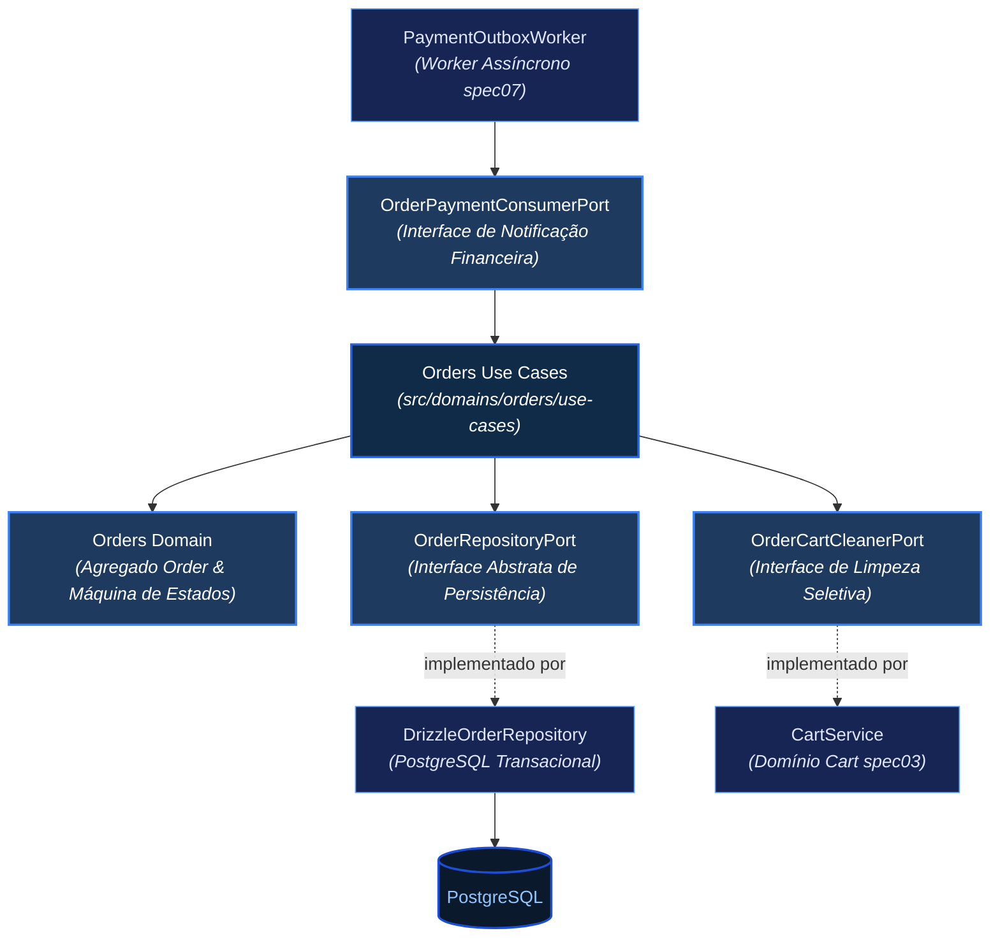
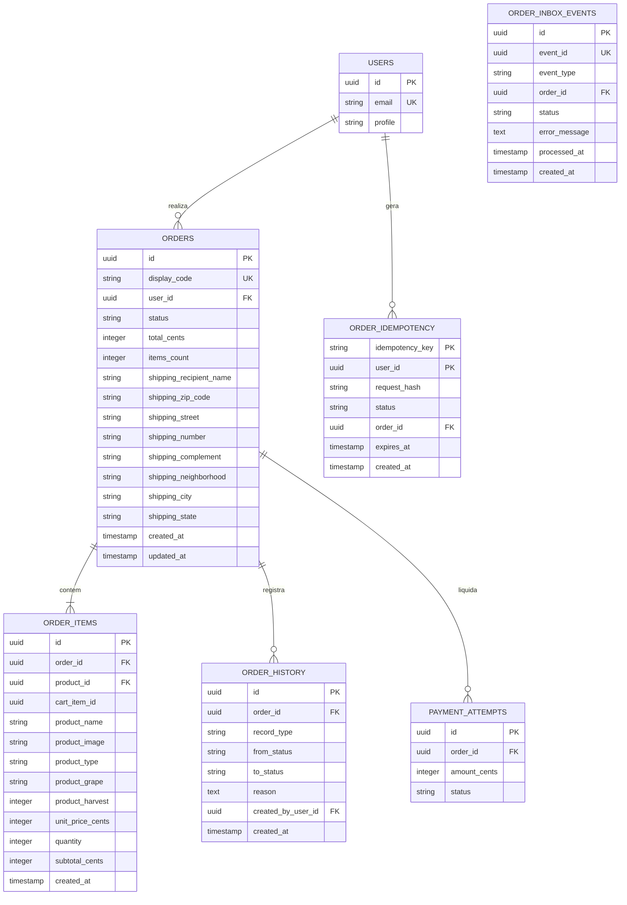
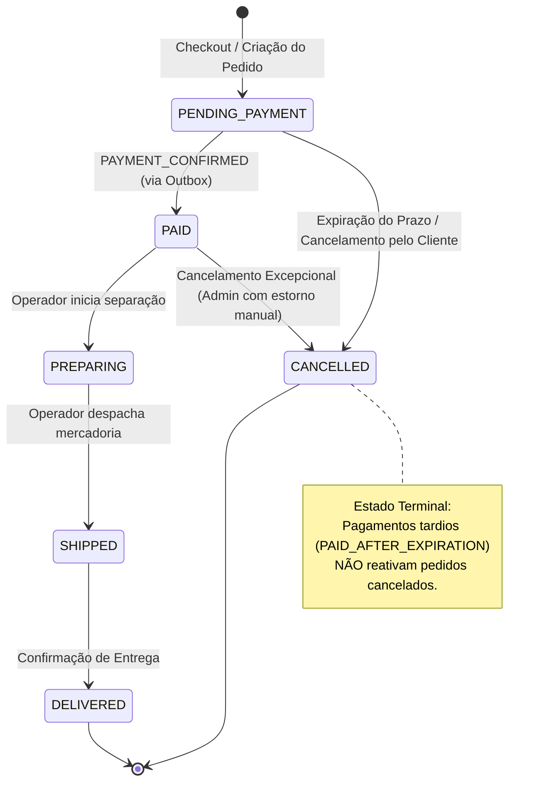
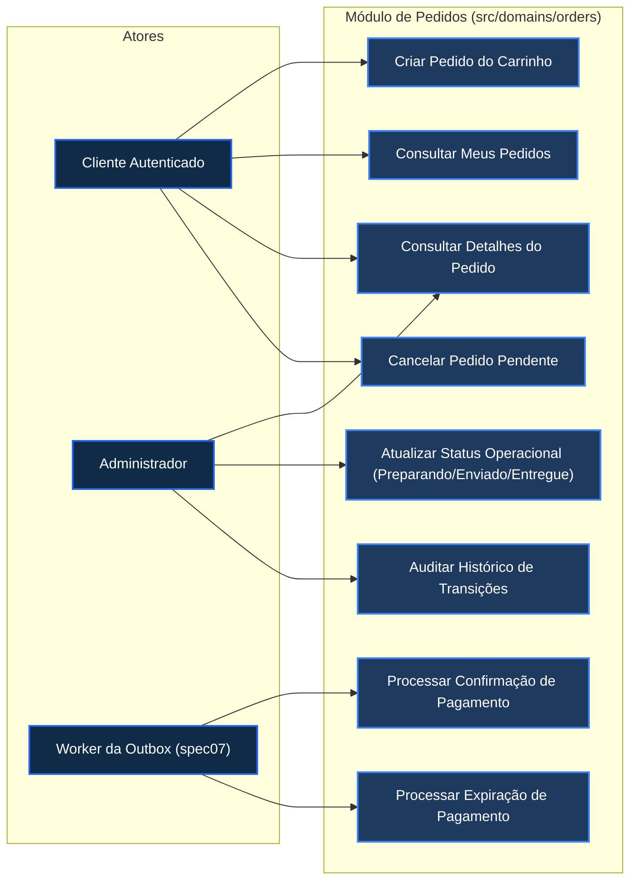
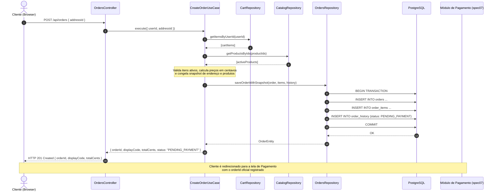
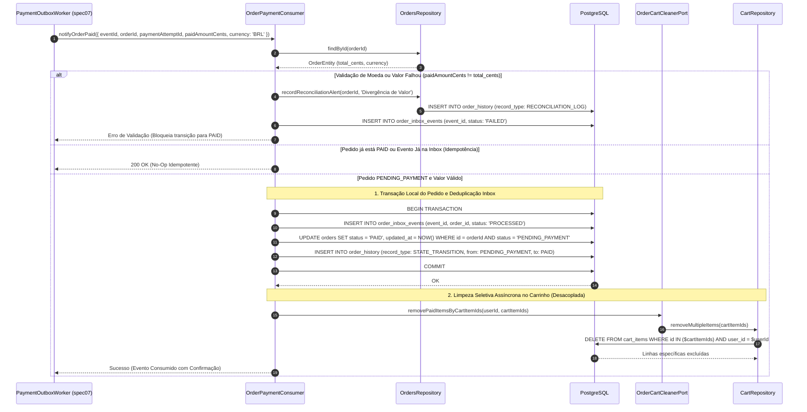
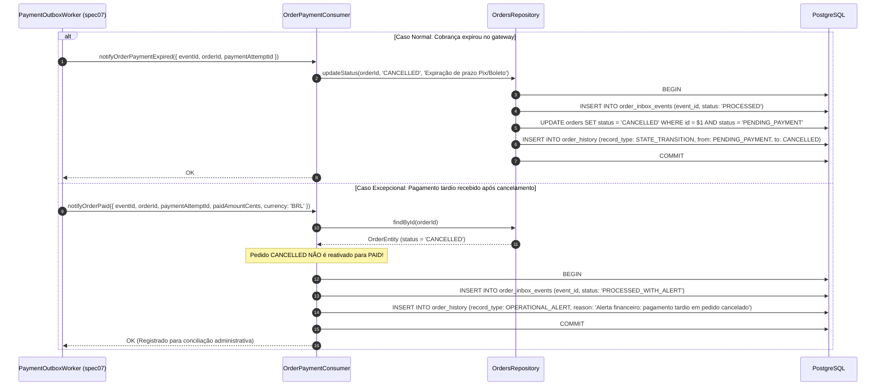

# Especificação Funcional e Arquitetural — Módulo de Pedidos (`spec08`)

---

## 1. Objetivo e Contexto

Definir formalmente o comportamento funcional, regras de negócio, modelagem relacional, máquina de estados, garantias transacionais e contratos de integração do **Módulo de Pedidos** (`Orders`) do e-commerce **Origem Vinhos**.

Esta especificação estabelece o agregador central de conversão de compras da plataforma, fundamentado nos princípios de **Arquitetura Hexagonal (Ports & Adapters)** estabelecidos em `docs/infra.md`. O módulo atua como a fronteira de imutabilidade contratual entre o catálogo, o carrinho de compras do cliente ([spec03-CRUD-Carrinho.md](./spec03-CRUD-Carrinho.md)) e a infraestrutura financeira de liquidação ([spec07-Pagamento.md](./spec07-Pagamento.md)), garantindo a integridade histórica dos dados, cálculo financeiro soberano no servidor em centavos inteiros e tolerância a falhas assíncronas.

---

## 2. Escopo do Módulo

### 2.1 O que esta especificação contempla
* **Conversão Atômica de Carrinho em Pedido:** Geração da ordem de compra a partir dos itens presentes no carrinho do usuário autenticado após seleção e validação obrigatória do endereço de entrega ([spec05-ViaCEP-Endereco.md](./spec05-ViaCEP-Endereco.md)).
* **Congelamento Imutável de Snapshot (Itens e Endereço):**
  * Cópia estática e permanente dos dados do produto no momento exato do fechamento (nome, imagem, safra, tipo de uva, preço unitário em centavos). Alterações cadastrais ou exclusões futuras no catálogo não afetam o pedido.
  * Cópia estática e desnormalizada do endereço de entrega selecionado no momento da compra. Alterações posteriores ou exclusão de endereços no perfil do cliente não adulteram entregas passadas.
* **Cálculo Soberano de Valores no Servidor:** O backend é a única fonte de verdade para a precificação. É expressamente proibido aceitar subtotais ou totais monetários informados pelo cliente frontend.
* **Identificador Amigável de Exibição (`display_code`):** Geração de código de rastreio alfanumérico legível (ex: `#OV-849201`) para comunicação com o cliente e suporte humano, mantendo o UUID v4 como chave primária (`id`) técnica interna.
* **Máquina de Estados Concorrente e Determinística:** Controle rigoroso dos estados do pedido: `PENDING_PAYMENT`, `PAID`, `PREPARING`, `SHIPPED`, `DELIVERED` e `CANCELLED`, com auditoria imutável (*append-only*) de cada transição.
* **Contrato com o Módulo de Pagamento (`spec07`):**
  * Exportação da interface imutável `OrderSnapshotForPayment` para que o gateway financeiro efetue a cobrança do valor exato.
  * Implementação da porta consumidora `OrderPaymentConsumerPort`, recebendo eventos assíncronos seguros via Transactional Outbox (`notifyOrderPaid`, `notifyOrderPaymentExpired`, `notifyOrderPaymentFailed`).
* **Esvaziamento Seletivo do Carrinho:** Limpeza exclusiva dos itens convertidos no pedido somente após a confirmação financeira (`PAYMENT_CONFIRMED`), preservando eventuais novos itens adicionados em compras paralelas.
* **Tratamento de Pagamentos Tardios (`PAID_AFTER_EXPIRATION`):** Isolamento de pedidos cancelados, impedindo reativação automática indevida e registrando alertas operacionais para conciliação administrativa.

### 2.2 O que NÃO contempla (Fora de Escopo da V1)
* **Cálculo Dinâmico e Tarifação de Frete:** Conforme `docs/prd_v1.md`, o frete é fixado como **Gratuito (R$ 0,00)** nesta versão.
* **Emissão Automatizada de Nota Fiscal Eletrônica (NF-e):** Faturamento e integração SEFAZ pertencem a módulos fiscais de fases posteriores.
* **Rastreamento de Transportadora em Tempo Real:** Atualizações logísticas detalhadas via correios/transportadoras externas ficam para a V2. O status de envio é atualizado pelo operador administrativo.
* **Fluxos de Devolução e Estorno Automático (Refunds):** Tratamento de devolução de produtos e cancelamento pós-entrega é realizado via SAC/Backoffice.

---

## 3. Glossário e Conceitos Fundamentais

* **Snapshot Imutável:** Cópia estática e independente dos dados de produtos e endereços gravada na tabela de pedidos no instante da criação, protegida contra mutações no banco de dados.
* **Centavos Inteiros (`total_cents`, `unit_price_cents`):** Representação monetária multiplicada por 100 em tipo inteiro (`INTEGER`), eliminando riscos de arredondamento em ponto flutuante binário (IEEE 754).
* **Display Code (`display_code`):** Código de negócio legível e único (ex: `#OV-849201`) exposto na interface do usuário e nos canais de comunicação, protegendo a chave primária técnica UUID contra exposição desnecessária.
* **Idempotência de Criação:** Garantia de que cliques múltiplos no botão "Finalizar Pedido" ou falhas transitórias de conexão gerem apenas um único pedido no banco de dados.
* **Transactional Outbox Consumer:** Padrão arquitetural em que o pedido consome eventos da fila de outbox gerada pelo módulo de pagamento, processando a confirmação de forma atômica e idempotente.
* **Anti-IDOR (Insecure Direct Object Reference):** Política de segurança estrita em que a consulta ou alteração de qualquer pedido exige a validação do `user_id` da sessão autenticada do solicitante, impedindo que um cliente visualize pedidos de terceiros.

---

## 4. Atores e Permissões

| Ator | Tipo | Responsabilidades e Limites de Acesso |
| :--- | :--- | :--- |
| **Cliente Autenticado** | Usuário (`Customer`) | Pode criar pedidos a partir de seu próprio carrinho, consultar o histórico e detalhes de seus próprios pedidos (Anti-IDOR) e solicitar o cancelamento de pedidos que estejam em `PENDING_PAYMENT`. Bloqueado de consultar ou alterar pedidos de outros clientes. |
| **Módulo de Pagamento** | Domínio Interno | Notifica o pedido sobre a confirmação, falha ou expiração da cobrança através da interface formal `OrderPaymentConsumerPort`. |
| **Sistema (Worker Outbox)** | Processo Automático | Consome eventos pendentes da `payment_outbox` e executa a transição de estado para `PAID` ou `CANCELLED` de forma assíncrona, confiável e idempotente. |
| **Administrador** | Usuário (`Admin`) | Pode consultar todos os pedidos da plataforma, filtrar por status, data e cliente, avançar manualmente o ciclo de expedição (`PAID` ➔ `PREPARING` ➔ `SHIPPED` ➔ `DELIVERED`) e tratar ocorrências operacionais de pagamentos tardios. |

---

## 5. Arquitetura do Domínio de Pedidos

Seguindo as diretrizes de `docs/infra.md`, o módulo reside em `src/domains/orders/`. O núcleo de domínio e casos de uso comunica-se unicamente através de **Ports (interfaces)**, permanecendo 100% desacoplado de detalhes de infraestrutura ou frameworks.



---

## 6. Modelagem de Dados e Entidades

O modelo relacional do PostgreSQL é gerenciado via **Drizzle ORM** em `src/infra/schema.ts`, projetado com integridade referencial estrita, índices de alta performance e fusos horários padronizados em UTC.

### 6.1 Diagrama Entidade-Relacionamento (ERD)



### 6.2 Especificação Detalhada das Tabelas

#### Tabela `orders` (Pedidos)
Representa a ordem de compra soberana e consolidada.

| Coluna | Tipo Drizzle / SQL | Restrições | Regra / Semântica |
| :--- | :--- | :--- | :--- |
| `id` | `uuid` | PK, `defaultRandom()` | Identificador universal e imutável do pedido. |
| `display_code` | `varchar(20)` | NOT NULL, Unique Index | Código legível de rastreio (ex: `'#OV-849201'`) para comunicação com cliente e suporte. |
| `user_id` | `uuid` | NOT NULL, FK `users.id` ON DELETE RESTRICT | Identificador do comprador autenticado (proteção Anti-IDOR). |
| `status` | `varchar(30)` | NOT NULL, Default `'PENDING_PAYMENT'` | Estado do pedido: `'PENDING_PAYMENT'`, `'PAID'`, `'PREPARING'`, `'SHIPPED'`, `'DELIVERED'`, `'CANCELLED'`. |
| `total_cents` | `integer` | NOT NULL | Valor total imutável em centavos inteiros (estritamente $> 0$, com check `total_cents > 0`). |
| `items_count` | `integer` | NOT NULL | Quantidade total acumulada de garrafas no pedido (check `items_count > 0`). |
| `currency` | `varchar(3)` | NOT NULL, Default `'BRL'` | Moeda oficial soberana da transação. |
| `shipping_recipient_name` | `varchar(150)` | NOT NULL | Nome da pessoa destinatária no momento da compra. |
| `shipping_zip_code` | `varchar(10)` | NOT NULL | CEP de entrega congelado (formato 00000-000). |
| `shipping_street` | `varchar(200)` | NOT NULL | Logradouro congelado. |
| `shipping_number` | `varchar(20)` | NOT NULL | Número predial congelado. |
| `shipping_complement`| `varchar(100)` | Nullable | Complemento (apto, bloco, etc.) congelado. |
| `shipping_neighborhood`| `varchar(100)`| NOT NULL | Bairro congelado. |
| `shipping_city` | `varchar(100)` | NOT NULL | Cidade de entrega congelada. |
| `shipping_state` | `varchar(2)` | NOT NULL | Sigla da Unidade Federativa (UF) congelada. |
| `created_at` | `timestamp` | NOT NULL, Default `now()` | Timestamp UTC de criação do pedido. |
| `updated_at` | `timestamp` | NOT NULL, Default `now()` | Timestamp UTC da última transição de estado. |

*Índices Obrigatórios:*
- `orders_user_created_idx`: Índice composto em `(user_id, created_at DESC)` para listagem ágil na tela "Meus Pedidos".
- `orders_status_idx`: Índice em `status` para filtros rápidos no painel administrativo.
- `orders_display_code_unique_idx`: Índice único em `display_code`.

---

#### Tabela `order_items` (Itens do Pedido — Snapshot Imutável)
Registra o snapshot histórico individual de cada vinho comprado.

| Coluna | Tipo Drizzle / SQL | Restrições | Regra / Semântica |
| :--- | :--- | :--- | :--- |
| `id` | `uuid` | PK, `defaultRandom()` | Identificador universal do item do pedido. |
| `order_id` | `uuid` | NOT NULL, FK `orders.id` ON DELETE RESTRICT | Vínculo com o pedido pai correspondente (protegido contra exclusão). |
| `product_id` | `uuid` | NOT NULL, FK `products.id` ON DELETE RESTRICT | Referência relacional ao produto original (permite soft delete lógico no catálogo, mas veta remoção física se houver pedidos). |
| `cart_item_id` | `uuid` | NOT NULL | Identificador do item de carrinho que originou esta linha (usado para limpeza seletiva e segura pós-pagamento). |
| `product_name` | `varchar(200)` | NOT NULL | Nome do vinho congelado na data da compra. |
| `product_image`| `text` | NOT NULL | Imagem do produto congelada. |
| `product_type` | `varchar(30)` | NOT NULL | Tipo do vinho (`Tinto`, `Branco`, etc.) congelado. |
| `product_grape`| `varchar(100)` | NOT NULL | Uva congelada. |
| `product_harvest`| `integer` | NOT NULL | Ano da safra congelado. |
| `unit_price_cents`| `integer` | NOT NULL | Preço unitário em centavos congelado (check `unit_price_cents > 0`). |
| `quantity` | `integer` | NOT NULL | Quantidade adquirida (check `quantity >= 1`). |
| `subtotal_cents` | `integer` | NOT NULL | Valor subtotal (`unit_price_cents * quantity`) em centavos. |
| `created_at` | `timestamp` | NOT NULL, Default `now()` | Timestamp UTC de registro do item. |

*Índices Obrigatórios:*
- `order_items_order_id_idx`: Índice em `order_id` para busca veloz dos itens de um pedido.
- `order_items_cart_item_idx`: Índice em `cart_item_id` para correlação com o carrinho.

---

#### Tabela `order_history` (Trilha de Auditoria e Eventos Operacionais)
Registra formalmente toda transição de status do pedido e eventos de reconciliação. Tabela restrita a operações de inserção (*append-only*), proibindo terminantemente `UPDATE` ou `DELETE`.

| Coluna | Tipo Drizzle / SQL | Restrições | Regra / Semântica |
| :--- | :--- | :--- | :--- |
| `id` | `uuid` | PK, `defaultRandom()` | Identificador do evento de auditoria. |
| `order_id` | `uuid` | NOT NULL, FK `orders.id` ON DELETE RESTRICT | Pedido auditado (proíbe deleção em cascata). |
| `record_type` | `varchar(30)` | NOT NULL, Default `'STATE_TRANSITION'` | Categoria: `'STATE_TRANSITION'`, `'OPERATIONAL_ALERT'`, `'RECONCILIATION_LOG'`. |
| `from_status` | `varchar(30)` | Nullable | Estado anterior (nulo no evento inicial ou em alertas operacionais sem transição). |
| `to_status` | `varchar(30)` | Nullable | Novo estado atribuído (preenchido apenas quando `record_type = 'STATE_TRANSITION'`). |
| `reason` | `text` | NOT NULL | Justificativa técnica ou humana (ex: *"Pedido criado via Checkout"*, *"Pagamento confirmado via outbox"*, *"ALERTA: Pagamento tardio recebido após cancelamento"*). |
| `created_by_user_id`| `uuid` | Nullable, FK `users.id` | Usuário executor (nulo se disparado pelo sistema/worker outbox). |
| `created_at` | `timestamp` | NOT NULL, Default `now()` | Timestamp UTC exato do evento. |

*Índice Obrigatório:*
- `order_history_order_created_idx`: Índice composto em `(order_id, created_at ASC)`.

---

#### Tabela `order_idempotency` (Prevenção de Pedidos Duplicados)
Controla disparos repetidos ou concorrentes na rota de criação de pedidos.

| Coluna | Tipo Drizzle / SQL | Restrições | Regra / Semântica |
| :--- | :--- | :--- | :--- |
| `idempotency_key` | `varchar(120)` | NOT NULL | Chave fornecida no cabeçalho HTTP `Idempotency-Key` (UUIDv4 gerado pelo frontend). |
| `user_id` | `uuid` | NOT NULL, FK `users.id` | Usuário autenticado que enviou a chave. |
| `request_hash` | `varchar(64)` | NOT NULL | Hash SHA-256 do corpo canônico da requisição (itens e endereço). |
| `status` | `varchar(20)` | NOT NULL, Default `'PROCESSING'` | Estado do lock: `'PROCESSING'`, `'COMPLETED'`, `'FAILED'`. |
| `order_id` | `uuid` | Nullable, FK `orders.id` | Pedido gerado após sucesso da criação. |
| `expires_at` | `timestamp` | NOT NULL | Validade do registro (retenção estrita de **24 horas** após criação). |
| `created_at` | `timestamp` | NOT NULL, Default `now()` | Timestamp UTC de inserção. |

*Chave Primária e Restrições Obrigatórias:*
- Chave Primária Composta: `PRIMARY KEY (idempotency_key, user_id)` (isola o escopo da chave estritamente por usuário autenticado, prevenindo sequestro de chaves entre clientes).
- Índice de expiração: `order_idempotency_expires_idx` em `expires_at` para limpeza periódica de registros antigos (> 24h).

---

#### Tabela `order_inbox_events` (Controle de Deduplicação de Eventos da Outbox)
Implementa o padrão **Idempotent Consumer / Inbox Pattern** para garantir processamento exatamente uma vez observável (*effectively-once*) de notificações assíncronas do módulo financeiro.

| Coluna | Tipo Drizzle / SQL | Restrições | Regra / Semântica |
| :--- | :--- | :--- | :--- |
| `id` | `uuid` | PK, `defaultRandom()` | Identificador universal da mensagem na inbox. |
| `event_id` | `uuid` | NOT NULL, Unique Index | ID original da mensagem na tabela `payment_outbox.id`. Garante unicidade de consumo. |
| `event_type` | `varchar(50)` | NOT NULL | Tipo do evento recebido (`PAYMENT_CONFIRMED`, `PAYMENT_EXPIRED`, etc.). |
| `order_id` | `uuid` | NOT NULL, FK `orders.id` | Pedido alvo do evento. |
| `status` | `varchar(20)` | NOT NULL, Default `'PROCESSED'` | Estado de processamento do evento local. |
| `error_message` | `text` | Nullable | Detalhes em caso de falha de validação ou inconsistência de valor. |
| `processed_at` | `timestamp` | NOT NULL, Default `now()` | Timestamp UTC de conclusão da transação de consumo. |
| `created_at` | `timestamp` | NOT NULL, Default `now()` | Timestamp UTC de recebimento do evento. |

*Índice Obrigatório:*
- `order_inbox_event_id_unique_idx`: Índice único em `event_id`.

---

## 7. Sete Áreas Críticas do Domínio de Pedidos

### 7.1. Ciclo de Vida e Máquina de Estados do Pedido

A máquina de estados do Pedido é independente da máquina de estados do Pagamento, comunicando-se exclusivamente por eventos de integração.



#### Tabela de Transições de Estado

| Estado Origem | Evento Disparador | Condição / Guarda | Estado Destino | Efeitos Colaterais / Ações |
| :--- | :--- | :--- | :--- | :--- |
| `(Inicial)` | `CreateOrderCommand` | Carrinho com $\ge 1$ item válido e endereço ativo. | `PENDING_PAYMENT` | Congela snapshot no DB; gera `display_code`; registra histórico. |
| `PENDING_PAYMENT` | `PAYMENT_CONFIRMED` | Evento validado com `paidAmountCents == order.total_cents` e `currency == 'BRL'`. | `PAID` | Atualiza status; registra histórico; agenda limpeza de itens do carrinho via `cart_item_id`. |
| `PENDING_PAYMENT` | `PAYMENT_EXPIRED` | Cobrança expirou no gateway sem liquidação e status local permanece `PENDING_PAYMENT`. | `CANCELLED` | Atualiza status para cancelado; registra motivo na auditoria. |
| `PENDING_PAYMENT` | `CancelOrderCommand` | Solicitado pelo cliente enquanto não há liquidação financeira confirmada. | `CANCELLED` | Atualiza status condicionalmente; registra cancelamento na auditoria. |
| `PAID` | `StartPreparationCommand`| Ação manual disparada por usuário com perfil `Admin`. | `PREPARING` | Pedido entra em fila de separação física na adega. |
| `PAID` | `AdminCancelCommand` | Ação manual do Administrador antes do despacho físico. | `CANCELLED` | Cancela expedição. (Registro operacional de pendência para resolução administrativa). |
| `PREPARING` | `DispatchOrderCommand` | Ação manual do Administrador ao postar a mercadoria. | `SHIPPED` | Registra despacho na adega com carimbo de tempo. |
| `SHIPPED` | `ConfirmDeliveryCommand` | Ação manual do Administrador ou integração logística. | `DELIVERED` | Ciclo de entrega concluído com sucesso (Estado Terminal). |

> **Nota sobre Notificação de Falha de Pagamento (`notifyOrderPaymentFailed`):**
> O recebimento de `PAYMENT_FAILED` (ex: cartão recusado) **não transita o pedido para `CANCELLED`**. Conforme a `spec07`, o pedido permanece em `PENDING_PAYMENT`, permitindo que o cliente realize uma nova tentativa com outro cartão ou outro meio de pagamento (`attempt_number` subsequente) sem forçar o recadastramento do pedido ou perder o carrinho. O evento de recusa é registrado exclusivamente como alerta na trilha de auditoria `order_history`.

---

### 7.2. Criação do Pedido, Validação Concorrente e Congelamento dos Preços

Para garantir a criação atômica sem inconsistências decorrentes de alterações concorrentes no carrinho ou catálogo entre a leitura e a escrita:

1. **Autenticação Obrigatória:** Apenas clientes autenticados com sessão JWT ativa (`users.id`) podem criar pedidos. Acesso anônimo retorna `HTTP 401`.
2. **Escopo e Validação da Chave de Idempotência (`order_idempotency`):**
   * A chave de idempotência é associada estritamente ao `user_id` autenticado via PK composta `(idempotency_key, user_id)`.
   * **Tratamento de Concorrência (Double-Click):** Na primeira requisição, o sistema insere o registro com `status = 'PROCESSING'` e validade de 24 horas.
   * Se uma requisição concorrente chegar com a mesma chave antes da conclusão:
     * Se `status == 'PROCESSING'`, o sistema retorna `HTTP 409 Conflict` com cabeçalho `Retry-After: 2`, impedindo duas transações concorrentes de criarem pedidos simultâneos.
     * Se `status == 'COMPLETED'`, o sistema valida se o `request_hash` (SHA-256 do payload canônico) é idêntico. Se for idêntico, retorna imediatamente o pedido já criado (`order_id`) com `HTTP 200/201`. Se o hash for diferente, rejeita com `HTTP 422 Unprocessable Entity` ("Uso indevido de chave de idempotência com payload divergente").
3. **Transação SQL Local e Leitura Protegida:**
   Dentro de uma transação serializável ou com lock de linha (`BEGIN ... COMMIT`):
   * O use case executa a leitura dos itens em `cart_items` para o `user_id` com lock compartilhado (`FOR SHARE` ou verificação de `updated_at`). Se o carrinho estiver vazio, aborta com `HTTP 422`.
   * Consulta os produtos correspondentes em `products`. Se algum produto sofreu soft delete (`deleted_at IS NOT NULL`), aborta com `HTTP 409 Conflict`.
4. **Conversão Decimal Financeira Segura (Prevenção de Erros de Arredondamento IEEE 754):**
   A coluna `products.price` é do tipo `numeric(10, 2)`. O backend **NÃO deve utilizar** conversão ingênua `Math.round(Number(price) * 100)`. Em vez disso, utiliza parsing decimal determinístico com inteiros:
   ```typescript
   export function parseNumericPriceToCents(priceStr: string | number): number {
     const str = typeof priceStr === 'number' ? priceStr.toFixed(2) : priceStr;
     const [integers, decimals = '00'] = str.split('.');
     const paddedDecimals = (decimals + '00').slice(0, 2);
     const cents = parseInt(integers, 10) * 100 + parseInt(paddedDecimals, 10);
     if (isNaN(cents) || cents <= 0) {
       throw new DomainError('Preço de produto inválido ou não positivo.');
     }
     return cents;
   }
   ```
5. **Cálculo Soberano e Snapshot Imutável:**
   * `unit_price_cents = parseNumericPriceToCents(product.price)`.
   * `subtotal_cents = unit_price_cents * cartItem.quantity`.
   * `total_cents = SUM(subtotal_cents)`.
   * Valida estritamente se `total_cents > 0` e `items_count > 0`.
   * Persiste o snapshot completo do produto em `order_items`, **incluindo obrigatoriamente a coluna `cart_item_id`** vinculada ao ID exato da linha em `cart_items`.
   * Grava o endereço de entrega desnormalizado em `orders`.
   * Atualiza a tabela `order_idempotency` para `status = 'COMPLETED'` e `order_id = orders.id`.
   * Grava o primeiro registro em `order_history` (`from_status = null`, `to_status = 'PENDING_PAYMENT'`).

---

### 7.3. Integração com o Módulo de Pagamento e Validação da Confirmação Financeira

A comunicação entre Pedidos e Pagamento segue contratos rigorosos:

1. **DTO de Leitura Imutável (`OrderSnapshotForPayment`):**
   ```typescript
   export interface OrderSnapshotForPayment {
     orderId: string;
     userId: string;
     totalCents: number;
     currency: 'BRL';
     items: Array<{
       productId: string;
       cartItemId: string;
       productName: string;
       unitPriceCents: number;
       quantity: number;
     }>;
   }
   ```
2. **Contrato do Consumidor de Eventos (`OrderPaymentConsumerPort`):**
   ```typescript
   export interface OrderPaymentConsumerPort {
     notifyOrderPaid(event: {
       eventId: string; // ID da payment_outbox para deduplicação
       orderId: string;
       paymentAttemptId: string;
       paidAmountCents: number;
       currency: string;
       occurredAt: Date;
     }): Promise<void>;

     notifyOrderPaymentExpired(event: {
       eventId: string;
       orderId: string;
       paymentAttemptId: string;
       occurredAt: Date;
     }): Promise<void>;

     notifyOrderPaymentFailed(event: {
       eventId: string;
       orderId: string;
       paymentAttemptId: string;
       reason: string;
       occurredAt: Date;
     }): Promise<void>;
   }
   ```

3. **Validação Rigorosa de Confirmação Financeira:**
   Ao receber o evento `notifyOrderPaid`, o use case de pedidos executa validações compulsórias **antes de autorizar a transição para `PAID`**:
   * **Identidade do Pedido e Moeda:** Verifica se `orderId` existe e se `event.currency === 'BRL'`.
   * **Conferência de Valor Efetivamente Pago:** Compara se `event.paidAmountCents === order.total_cents`.
   * **Tratamento de Divergência de Valor:** Se `paidAmountCents !== order.total_cents` (ex: valor menor ou inconsistente reportado pelo provedor):
     * A transição automática para `PAID` é **bloqueada**.
     * O pedido permanece em `PENDING_PAYMENT`.
     * O evento é gravado em `order_history` com `record_type = 'RECONCILIATION_LOG'` e motivo detalhado: `"DIVERGÊNCIA FINANCEIRA: Pedido total R$ ${(order.total_cents/100).toFixed(2)}, mas provedor notificou R$ ${(event.paidAmountCents/100).toFixed(2)}. Requer auditoria administrativa."`.
     * Registra em `order_inbox_events` como `status = 'FAILED'` e não reconhece a liquidação automática.

---

### 7.4. Resolução de Concorrência entre Cancelamento e Pagamento

O cancelamento do pedido e a confirmação financeira podem colidir no tempo. Para resolver corridas sem inconsistências:

1. **Cancelamento do Pedido vs Cancelamento da Cobrança:**
   O cancelamento lógico do pedido no sistema não cancela de forma instantânea uma cobrança que já esteja sendo liquidada na rede bancária pelo cliente.
2. **Transição Condicional Atômica (Optimistic Locking):**
   Toda transição de cancelamento ou pagamento executa updates condicionais no banco de dados:
   * **Confirmação:**
     ```sql
     UPDATE orders 
     SET status = 'PAID', updated_at = NOW() 
     WHERE id = $1 AND status = 'PENDING_PAYMENT';
     ```
   * **Cancelamento:**
     ```sql
     UPDATE orders 
     SET status = 'CANCELLED', updated_at = NOW() 
     WHERE id = $1 AND status = 'PENDING_PAYMENT';
     ```
3. **Cenário de Concorrência 1 — Cancelamento Ganha a Corrida:**
   Se a solicitação de cancelamento for persistida primeiro (`status = 'CANCELLED'`), o update de confirmação financeira subsequente encontrará 0 linhas afetadas.
   * O sistema detecta que o pedido já está `CANCELLED`.
   * **Regra Soberana:** O pedido **NÃO é reativado para `PAID`**.
   * O use case registra em `order_history` um registro do tipo `OPERATIONAL_ALERT`: `"ALERTA: Pagamento tardio recebido para pedido já cancelado (Attempt: ${paymentAttemptId}). Encaminhado para conciliação administrativa."`.
   * O evento é marcado como processado com alerta na inbox, notificando o painel de atendimento.
4. **Cenário de Concorrência 2 — Confirmação Ganha a Corrida:**
   Se a confirmação financeira for processada primeiro (`status = 'PAID'`), uma tentativa posterior de cancelamento via cliente é rejeitada com `HTTP 409 Conflict` ("O pedido já foi confirmado financeiramente e não pode ser cancelado pelo cliente").

---

### 7.5. Processamento Confiável da Outbox, Inbox Pattern e Limpeza Seletiva do Carrinho

A integração assíncrona entre Pagamento, Pedidos e Carrinho é coordenada para prevenir inconsistências causadas por falhas transitórias:

1. **Desacoplamento Transacional Explícito:**
   * A transição de estado do pedido para `PAID` e a exclusão física de itens do carrinho **não ocorrem na mesma transação de banco de dados** e não compartilham locks prolongados.
2. **Deduplicação com Inbox Pattern (`order_inbox_events`):**
   Para cada evento despachado pelo worker da outbox (`payment_outbox`):
   * O use case inicia uma transação local de curta duração:
     ```sql
     BEGIN TRANSACTION;
     -- Tenta registrar o evento na inbox
     INSERT INTO order_inbox_events (event_id, event_type, order_id, status)
     VALUES ($1, $2, $3, 'PROCESSING');
     -- Se event_id já existir (violação de chave única), faz ROLLBACK e retorna sucesso (idempotente)
     ```
   * Atualiza condicionalmente `orders` de `PENDING_PAYMENT` para `PAID`.
   * Insere o registro de transição em `order_history`.
   * Atualiza `order_inbox_events` para `status = 'PROCESSED'`.
   * `COMMIT;`
3. **Limpeza Seletiva Precisa do Carrinho baseada em `cart_item_id`:**
   Após a conclusão bem-sucedida da transação do pedido, o sistema aciona o `OrderCartCleanerPort`:
   * **Problema Resolvido:** Se o cliente possuía 2 garrafas do Vinho X no pedido e, enquanto a cobrança estava pendente, adicionou mais 1 garrafa ou alterou a quantidade no carrinho, **não se deve excluir por `product_id`**.
   * **Mecanismo Seguro:** O use case recupera os `cart_item_id` exatos gravados na tabela `order_items` durante a criação do pedido.
   * Invoca a exclusão no carrinho passando os IDs específicos das linhas:
     ```sql
     DELETE FROM cart_items WHERE id IN ($cart_item_ids) AND user_id = $userId;
     ```
   * Dessa forma, apenas as linhas originais do pedido são removidas. Se o usuário alterou quantidades ou gerou novos itens, os itens atuais são preservados.
4. **Tolerância a Falhas na Limpeza do Carrinho:**
   Se a chamada ao repositório do carrinho falhar (ex: timeout de rede ou lock temporário):
   * O pedido já está com status `PAID` garantido no banco.
   * O erro de limpeza do carrinho é capturado, registrado em log e agendado para nova tentativa assíncrona, sem reverter o pedido para não pago.

---

### 7.6. Integração entre Pedidos e Pagamentos (Contratos Formais)

O fluxo de comunicação e dependência entre os dois módulos é estruturado conforme a tabela:

| Direção | Mecanismo | Contrato / Interface | Garantia |
| :--- | :--- | :--- | :--- |
| `Payment` ➔ `Orders` | Leitura síncrona em memória | `OrderSnapshotForPayment` | Preço, moeda e itens imutáveis soberanos para cobrança. |
| `Payment` ➔ `Orders` | Evento assíncrono via Outbox | `OrderPaymentConsumerPort.notifyOrderPaid` | Validação estrita de valor e moeda; idempotência via Inbox. |
| `Payment` ➔ `Orders` | Evento assíncrono via Outbox | `OrderPaymentConsumerPort.notifyOrderPaymentExpired` | Transição determinística para `CANCELLED` com guarda condicional. |
| `Payment` ➔ `Orders` | Evento assíncrono via Outbox | `OrderPaymentConsumerPort.notifyOrderPaymentFailed` | Registro de alerta na auditoria; pedido permanece em `PENDING_PAYMENT`. |
| `Orders` ➔ `Cart` | Invocação assíncrona pós-pago | `OrderCartCleanerPort.removePaidItemsByCartItemIds` | Remoção seletiva baseada em `cart_item_id`, imune a alterações concorrentes. |

---

### 7.7. Estratégia de Migração Drizzle e Índices de Performance

A criação física das tabelas `orders`, `order_items`, `order_history` e `order_idempotency` será adicionada em `src/infra/schema.ts` preservando total retrocompatibilidade com o schema existente de usuários, produtos e carrinho.

A tabela `payment_attempts` da `spec07` utilizará a chave estrangeira física vinculada diretamente a `orders.id`:
```typescript
orderId: uuid('order_id').notNull().references(() => orders.id, { onDelete: 'restrict' })
```
O modo `onDelete: 'restrict'` garante que um pedido jamais possa ser deletado do banco de dados enquanto possuir registros financeiros associados.

---

## 8. Diagramas Mermaid Técnicos e Didáticos

### 8.1. Diagrama de Casos de Uso do Módulo de Pedidos



---

### 8.2. Diagrama de Sequência: Criação do Pedido e Hand-off para Pagamento



---

### 8.3. Diagrama de Sequência: Confirmação Financeira, Pedido e Limpeza do Carrinho



---

### 8.4. Diagrama de Sequência: Cancelamento por Expiração e Pagamento Tardio



---

## 9. Critérios de Aceitação e Testes (BDD)

### Cenário 1: Criação de pedido com sucesso a partir do carrinho
* **Dado** que um cliente autenticado possui 2 garrafas de vinho no carrinho (preço atual no catálogo: R$ 120,00 cada);
* **E** possui um endereço de entrega cadastrado e válido;
* **Quando** o cliente envia a requisição de criação de pedido informando o `addressId`;
* **Então** o sistema deve criar um pedido no estado `PENDING_PAYMENT`;
* **E** o valor `total_cents` deve ser exatamente `24000` (R$ 240,00);
* **E** os itens devem ser gravados em `order_items` contendo o `cart_item_id` e o snapshot imutável dos vinhos;
* **E** o endereço deve ser gravado desnormalizado em `orders`;
* **E** os itens do carrinho original do cliente devem permanecer preservados.

---

### Cenário 2: Tentativa de criação de pedido com carrinho vazio
* **Dado** que um cliente autenticado não possui nenhum produto no carrinho;
* **Quando** o cliente tenta disparar a criação de um pedido;
* **Então** a requisição deve ser rejeitada com `HTTP 422 Unprocessable Entity`;
* **E** nenhum registro deve ser criado nas tabelas `orders` ou `order_items`.

---

### Cenário 3: Produto removido do catálogo durante o checkout
* **Dado** que um vinho presente no carrinho do cliente sofreu soft delete (`deleted_at IS NOT NULL`) no catálogo antes do fechamento;
* **Quando** o cliente tenta finalizar o pedido;
* **Então** a criação deve ser bloqueada com `HTTP 409 Conflict`;
* **E** a mensagem de erro deve indicar que o item não está mais disponível, solicitando atualização do carrinho.

---

### Cenário 4: Preço do catálogo alterado durante a montagem do pedido
* **Dado** que um vinho custava R$ 100,00 quando foi adicionado ao carrinho, mas o catálogo foi reajustado para R$ 110,00;
* **Quando** o cliente clica em "Finalizar Compra";
* **Então** o cálculo soberano do backend via parsing decimal deve utilizar o preço vigente no catálogo no momento da criação (`11000` centavos);
* **E** qualquer valor inferior enviado pelo frontend deve ser desconsiderado.

---

### Cenário 5: Idempotência de criação de pedido e concorrência de duplo clique
* **Dado** que um cliente submete a criação de pedido com a chave `Idempotency-Key: idemp-ord-123`;
* **Quando** uma segunda requisição concorrente for enviada com a mesma chave enquanto a primeira está em processamento (`status = 'PROCESSING'`);
* **Então** o sistema deve responder com `HTTP 409 Conflict` e cabeçalho `Retry-After: 2`;
* **E** quando a primeira requisição for concluída (`status = 'COMPLETED'`), nova repetição idêntica deve retornar o pedido já criado com `HTTP 200/201` sem duplicar linhas no banco.

---

### Cenário 6: Confirmação de pagamento via Outbox e esvaziamento seletivo preciso
* **Dado** um pedido no estado `PENDING_PAYMENT` contendo 2 garrafas do Vinho A (referente a `cart_item_id = 'c-1'`);
* **E** enquanto aguardava pagamento, o cliente adicionou ao carrinho mais 1 garrafa do Vinho A (criando ou atualizando nova linha) ou um Vinho B;
* **Quando** o worker da outbox financeira processa a confirmação de pagamento (`PAYMENT_CONFIRMED`);
* **Então** o pedido deve transitar para o estado `PAID`;
* **E** o sistema deve invocar a exclusão seletiva no carrinho filtrando exclusivamente por `cart_item_id = 'c-1'`;
* **E** os itens ou quantidades subsequentes devem permanecer intactos no carrinho do cliente.

---

### Cenário 7: Falha de validação financeira por valor divergente
* **Dado** um pedido registrado com `total_cents = 25000` (R$ 250,00);
* **Quando** o worker da outbox envia `notifyOrderPaid` com `paidAmountCents = 20000` (R$ 200,00);
* **Então** o pedido NÃO deve transitar para `PAID`, permanecendo em `PENDING_PAYMENT`;
* **E** um registro na tabela `order_history` deve ser gravado com `record_type = 'RECONCILIATION_LOG'` apontando a discrepância;
* **E** o evento deve ser marcado como `FAILED` na inbox para auditoria administrativa.

---

### Cenário 8: Idempotência do consumidor de pagamento via Inbox
* **Dado** que um evento com `eventId = 'evt-999'` já foi processado na inbox;
* **Quando** o mesmo evento for reenviado pelo worker por política de retry da outbox;
* **Então** a restrição única de `order_inbox_events` deve detectar a repetição e abortar o reprocessamento;
* **E** o pedido deve permanecer em `PAID` sem duplicar registros de histórico nem refazer exclusões no carrinho.

---

### Cenário 9: Cancelamento de pedido por expiração financeira
* **Dado** um pedido no estado `PENDING_PAYMENT`;
* **Quando** o worker da outbox financeira envia `notifyOrderPaymentExpired`;
* **Então** o status do pedido deve ser atualizado condicionalmente para `CANCELLED`;
* **E** um registro na tabela `order_history` deve documentar a expiração do prazo de pagamento.

---

### Cenário 10: Pagamento tardio recebido para pedido já cancelado
* **Dado** um pedido que foi cancelado (`CANCELLED`) por timeout de Pix ou cancelamento do usuário;
* **Quando** o worker da outbox financeira envia uma notificação `notifyOrderPaid` referente a pagamento tardio (`PAID_AFTER_EXPIRATION`);
* **Então** o pedido NÃO deve ser reativado para `PAID`, permanecendo `CANCELLED`;
* **E** um evento de auditoria operacional (`record_type = 'OPERATIONAL_ALERT'`) deve ser registrado em `order_history` para tratamento pelo administrador.

---

### Cenário 11: Cancelamento manual pelo cliente antes do pagamento
* **Dado** um pedido no estado `PENDING_PAYMENT` pertencente ao usuário logado;
* **Quando** o cliente aciona o cancelamento na tela de detalhes do pedido;
* **Então** o pedido deve transitar para `CANCELLED` via update condicional;
* **E** qualquer confirmação tardia subsequente não poderá reativar o pedido.

---

### Cenário 12: Proteção Anti-IDOR na consulta de pedidos
* **Dado** que o Cliente A possui a sessão autenticada com ID `usr-111`;
* **E** o Pedido `#OV-123` pertence ao Cliente B com ID `usr-222`;
* **Quando** o Cliente A tenta consultar `/api/orders/{pedido-do-cliente-b}`;
* **Então** o sistema deve retornar `HTTP 403 Forbidden`;
* **E** nenhum dado do pedido deve ser exposto na resposta.

---

### Cenário 13: Avanço de fluxo logístico pelo Administrador
* **Dado** um pedido no estado `PAID`;
* **Quando** um usuário com perfil `Admin` aciona a transição para `PREPARING`;
* **Então** o pedido deve transitar com sucesso para `PREPARING`;
* **E** o `created_by_user_id` no histórico deve apontar para o ID do administrador executor.

---

### Cenário 14: Tentativa de avanço de fluxo logístico por Cliente comum
* **Dado** um pedido no estado `PAID`;
* **Quando** um usuário com perfil `Customer` tenta enviar requisição para transitar para `PREPARING` ou `SHIPPED`;
* **Então** o sistema deve rejeitar a requisição com `HTTP 403 Forbidden`.

---

### Cenário 15: Tentativa de pular etapas do ciclo de vida
* **Dado** um pedido no estado `PENDING_PAYMENT`;
* **Quando** um operador tenta enviar o comando de despacho (`SHIPPED`) sem o pagamento ter sido confirmado;
* **Então** a transição deve ser categoricamente rejeitada com `HTTP 422 Unprocessable Entity`;
* **E** o pedido deve permanecer inalterado em `PENDING_PAYMENT`.

---

### Cenário 16: Imutabilidade do histórico após alteração no cadastro de endereço ou catálogo
* **Dado** um pedido finalizado com sucesso entregue na Rua das Videiras, 100 com vinho comprado por R$ 90,00;
* **Quando** o cliente altera seu endereço no perfil para Avenida Brasil e o administrador altera o preço do vinho no catálogo para R$ 150,00;
* **Então** a consulta aos detalhes do pedido histórico deve continuar exibindo Rua das Videiras, 100 e o valor de R$ 90,00 de forma imutável.

---

## 10. Matriz de Rastreabilidade e Pendências

### 10.1. Rastreabilidade com Especificações Relacionadas
* **`spec02-CRUD-Catalogo.md`:** Fornece os produtos ativos para validação e extração de preços no servidor.
* **`spec03-CRUD-Carrinho.md`:** Fornece a fonte de dados do carrinho e implementa a porta `OrderCartCleanerPort` para remoção seletiva pós-pagamento.
* **`spec05-ViaCEP-Endereco.md`:** Fornece os endereços cadastrados do usuário para seleção e congelamento de snapshot no pedido.
* **`spec07-Pagamento.md`:** Consome o `OrderSnapshotForPayment` e notifica o pedido via `payment_outbox` através da porta `OrderPaymentConsumerPort`.

### 10.2. Status de Prontidão
* **Status:** **Pronta para Aprovação**.
* **Pendências Bloqueadoras:** Nenhuma.
* **Pendências Não-Bloqueadoras (Evolução Futura V2):**
  - Implementação de cálculo dinâmico de frete por CEP (hoje fixado como Frete Grátis na V1).
  - Emissão de Nota Fiscal Eletrônica e integração SEFAZ.

